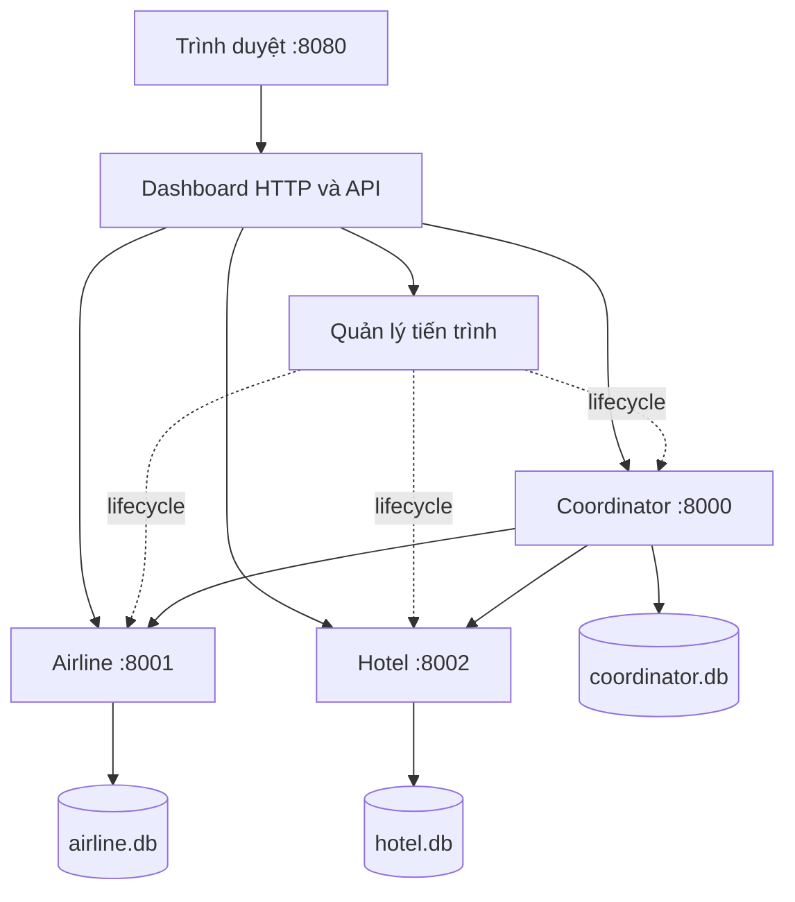

# Đặc tả dashboard web điều khiển và trình diễn 2PC

## 1. Mục tiêu và trạng thái

Dashboard là ứng dụng web cục bộ để nhóm và giảng viên quan sát giao dịch đặt combo một chỗ máy bay và một phòng khách sạn bằng 2PC. Backend/CLI hiện có là nền tảng. Cập nhật 09/11: API độc lập của Khoa đã có entry `run_dashboard_api.py`; UI và process manager thật chưa tích hợp, chưa nghiệm thu dashboard/browser. Phần dưới giữ yêu cầu mục tiêu; xem mục 8 để nối API. Giữ 14 ngày/126 giờ công theo [kế hoạch nhóm](plan.md).

Phạm vi: đặt/retry, tồn kho, giao dịch/ACK/events, gây lỗi, chạy/dừng/khởi động lại ba dịch vụ ngay trên trình duyệt. Đăng nhập khách hàng, thanh toán, lịch bay/ngày nhận phòng và triển khai Internet ngoài bản này.

## 2. Bố cục và hành vi giao diện

Tiếng Việt, nền sáng, chữ/độ tương phản phù hợp trình chiếu. Bố cục ưu tiên laptop từ 1280 px, co thành một cột ở màn hình nhỏ. Trạng thái có chữ đi cùng màu; nút hỗ trợ bàn phím, có chờ/lỗi; polling không làm mất focus hoặc lựa chọn giao dịch.

```text
ĐẶT COMBO DU LỊCH — TRÌNH DIỄN 2PC          Cập nhật lần cuối
[Coordinator: trạng thái + Chạy/Dừng/Khởi động lại]
[Airline: trạng thái + điều khiển] [Hotel: trạng thái + điều khiển]
[Máy bay: tồn / giữ / chưa giữ]    [Phòng: tồn / giữ / chưa giữ]
[Đặt combo: mã yêu cầu, DEFAULT/MISSING, Đặt, Gửi lại]
[Demo: node, điểm crash/delay, kích hoạt, tải đồng thời]
[Bảng giao dịch + bộ lọc]          [Chi tiết giao dịch được chọn]
```

| Khu vực | Dữ liệu và thao tác |
|---|---|
| Dịch vụ | Ba node, trạng thái đang khởi động/đang chạy/đang dừng/đã dừng/bị lỗi. Nút Chạy/Dừng/Khởi động lại theo trạng thái; khóa thao tác lặp khi đang xử lý. Phân biệt child sống với health lỗi. |
| Tồn kho | Hai ô lớn: available là tồn chưa trừ commit; số giữ từ PREPARED/locks; chưa giữ = max(available − số giữ, 0). Do khóa độc quyền theo resource, nếu DEFAULT có lock thì ghi “Tạm khóa — chờ quyết định”; con số chưa giữ không hứa nhận được booking mới. |
| Đặt combo | Airline DEFAULT, Hotel DEFAULT hoặc MISSING; token mới cho yêu cầu mới; hiển thị tx và kết quả. Gửi lại giữ nguyên token/payload. Booking mới sau ABORTED dùng token mới. |
| Giao dịch | tx, token, quyết định Coordinator, trạng thái Airline/Hotel và ACK/2. Lọc tất cả/đang xử lý/commit/abort/chưa đủ xác nhận. |
| Chi tiết | Payload, ACK, reservation, khóa và events từng node. Thứ tự trong node theo seq; không suy diễn thứ tự toàn cục từ timestamp khác node. |
| Demo | Chọn node và điểm lỗi hợp lệ, mode crash/delay, kích hoạt một lần; load mặc định 10 booking/4 worker, có tiến độ và kết quả từng yêu cầu. |

Node không truy cập được: ghi “Không xác định”, lỗi và lần đọc thành công cuối; cache gắn nhãn “Dữ liệu cũ”. Chưa có snapshot thì để chưa có dữ liệu, không thay tồn bằng 0. Các snapshot không phải distributed snapshot nhất quán.

Mất phản hồi booking: “Chưa xác định kết quả — kiểm tra hoặc gửi lại cùng yêu cầu”. COMMITTED/complete=false: “Đã quyết định COMMIT, đang chờ xác nhận”; hoàn tất khi đủ hai ACK. UI/timeout không tự đổi ACTIVE/PREPARING/PREPARED thành ABORTED.

Lưu token/payload của yêu cầu chưa phân giải vào localStorage **trước gửi**, khôi phục sau reload. Không tái dùng token với payload khác. Khóa nút gửi lặp; idempotency backend bảo đảm khi nhiều tab/retry. Không bịa events hoặc làm chậm quyết định cho animation; trạng thái ngắn giữa các lần polling được giải thích qua log thực và fault.

## 3. Kiến trúc dự kiến



HTML/CSS/JavaScript thuần; dashboard Python dùng thư viện chuẩn, không cần Node/npm/framework runtime. Lệnh dự kiến `python run_dashboard.py` phục vụ `http://127.0.0.1:8080`, tự khởi chạy ba dịch vụ bằng cùng interpreter. Dashboard/supervisor nằm ngoài các child nghiệp vụ nên Coordinator chết không kéo sập web. RPC và CLI hiện tại giữ tương thích.

Đọc qua RPC health/snapshot/status, không mở DB nghiệp vụ trực tiếp. Tổng hợp các node song song, timeout đọc 2 giây/node; lỗi từng node không làm mất dữ liệu node khỏe. Poll mỗi giây khi request trước đã hoàn tất để tránh chồng request; trả freshness/lỗi riêng từng node. Cache trong bộ nhớ; dashboard restart đọc lại qua RPC, localStorage giữ yêu cầu chưa rõ kết quả.

## 4. API web dự kiến

JSON; lỗi HTTP dashboard tách khỏi quy ước RPC nghiệp vụ. Dùng 400 đầu vào sai, 404 tên/ID không tồn tại, 409 xung đột/cổng bận, 502/504 lỗi/timeout upstream. Lỗi booking kèm token và `outcome_unknown` khi chưa biết kết quả; không suy quyết định từ HTTP status. Chỉ kết luận tx không tồn tại khi Coordinator truy cập được và trả đúng lỗi đó.

| Phương thức/đường dẫn | Đầu vào | Hành vi tối thiểu |
|---|---|---|
| GET `/api/overview` | Không | Lifecycle/health, tồn/khóa, giao dịch/ACK; snapshot, thời điểm đọc và lỗi riêng từng node |
| POST `/api/bookings` | token, airline, hotel | Begin rồi end cùng payload; trả tx/state/complete/ack; token/resource không rỗng, tối đa 128 ký tự theo backend |
| GET `/api/transactions/{tx}` | tx | Quyết định/ACK, participant/events; unavailable riêng từng node |
| POST `/api/services/{name}/{action}` | Coordinator/Airline/Hotel; start/stop/restart | Lifecycle qua service map cố định; chờ có giới hạn, transitional state qua overview |
| POST `/api/faults` | service, point, mode, seconds nếu delay | Arm hook một lần đúng vai trò; báo lỗi nếu node chưa sẵn sàng |
| POST `/api/load` | count=10, workers=4 mặc định | Trả 202 và run_id; chạy nền với token riêng từng yêu cầu |
| GET `/api/load/{run_id}` | run_id | Tổng/đã xử lý, đang chạy/hoàn tất, kết quả từng token/tx; lỗi mạng vẫn có thể outcome unknown |

Load giới hạn count 1–50, workers 1–8; chỉ một đợt tại một thời điểm, đợt mới khi đang chạy trả 409. Kết quả lưu trong bộ nhớ vòng đời dashboard. Booking upstream chờ tối đa 30 giây; start chờ health tối đa 10 giây, stop chờ tối đa 5 giây rồi kết thúc cưỡng bức đúng child sở hữu.

Fault theo vai trò: Coordinator có after_votes, after_decision, after_ack_airline; RM có before_prepare, after_prepare, before_commit, after_commit. Mode crash/delay, seconds 0–30 theo backend. Một kịch bản chính chỉ arm một lỗi; restart node xóa hook chưa chạy trong bộ nhớ node.

## 5. Quản lý tiến trình

- Chỉ điều khiển child do dashboard tạo bằng Popen; argv/service map cố định, shell=False, root/DB xác định ở server. Không nhận lệnh shell, executable hoặc đường dẫn từ browser.
- Cổng bị chiếm: báo lỗi, không tự sở hữu hoặc giết tiến trình ngoài. Theo dõi child exit và health để tránh coi chương trình ngoài là child vừa tạo.
- Start đang chạy không tạo child mới; stop đã dừng không tác động gì. Tuần tự hóa lifecycle từng node; start/restart hoàn tất khi child sống và health đúng vai trò. Lỗi phải có lý do/log.
- Restart dùng đúng DB cũ. Crash một node không dừng web/hai node kia, không tự restart trước khi người demo quan sát. Lỗi RPC không thoát vòng giám sát.
- stdout/stderr vào log theo dịch vụ, tránh pipe không đọc gây treo. Ctrl+C/đóng chương trình được xử lý bằng cleanup child sở hữu, giữ DB; không hứa cleanup khi OS cưỡng bức hủy supervisor.
- Chỉ bind loopback; kiểm tra Host/Origin cùng nguồn, token phiên cho POST; không CORS mở. Giới hạn này bảo vệ bộ điều khiển demo, không thay đổi RPC nghiệp vụ.
- Không có nút reset DB trong bản đầu. Chuẩn bị sạch bằng dừng dịch vụ và lưu trữ/đổi tên data trước buổi demo; không reset giữa crash/recovery. Không chạy run_demo.py đồng thời vì cùng cổng và script đó dừng cả cụm khi một node chết.

## 6. Kịch bản bảo vệ 12–15 phút

| Bước | Thao tác trên web | Quan sát mong đợi |
|---|---|---|
| 1 | Khởi chạy, giới thiệu | Ba node khỏe, mỗi RM mới có 5 DEFAULT, ba DB riêng |
| 2 | Đặt combo mới | COMMITTED/đủ ACK; tồn 5 → 4 hai bên |
| 3 | Gửi lại, có thể reload trước | Cùng token/tx; tồn vẫn 4 |
| 4 | Yêu cầu mới hotel MISSING | ABORTED, giải phóng khóa, tồn giữ nguyên |
| 5 | Arm Coordinator after_votes/crash, đặt, quan sát rồi Restart | Unknown trên client; hai RM PREPARED giữ khóa; restart từ PREPARING dẫn tới abort và giải phóng khóa |
| 6 | Arm after_decision/crash, đặt rồi Restart | Giữ COMMITTED, replay đủ ACK, tồn mỗi bên 4 → 3 đúng một lần |
| 7 | Load 10 booking/4 worker | UI theo dõi tiến độ; số commit không vượt 3 tài nguyên còn lại; lượng giảm tồn khớp commit |

Khóa độc quyền từ chối khi xung đột nên bước 7 không bắt buộc đúng 3 commit trong mọi lịch chạy; cần chứng minh không oversell. Con số trong bảng là mong đợi trên DB mới, chưa phải kết quả dashboard đã chạy.

Phần bổ sung: Hotel crash after_prepare rồi restart nhận abort; after_commit để mất ACK nhưng không trừ hai lần; before_prepare/delay 3 giây vượt RPC timeout 2 giây, chờ thông điệp muộn và đối chiếu tombstone/locks. Token mới cho yêu cầu mới, retry giữ token gốc; DB luôn giữ nguyên khi phục hồi.

SV1 trình bày quyết định/ACK; SV2 giải thích tồn, ghi tạm, khóa; SV3 thao tác web/retry/fault/load. CLI/terminal dùng đối chiếu và dự phòng, không thay mục tiêu điều khiển toàn bộ qua web.

## 7. Kiểm thử và nghiệm thu

Giữ 14 test backend. Bổ sung test API với lỗi node từng phần, timeout, retry và load; test process manager với child thật, cổng bị chiếm, lifecycle lặp, restart giữ DB và cleanup đúng ownership. Dùng data tạm/cổng riêng để không tác động dữ liệu demo.

- [ ] Đặt/abort, lọc và chi tiết lấy dữ liệu thật.
- [ ] Double-click, nhiều tab, retry và reload không đặt trùng; payload cũ giữ nguyên.
- [ ] Web hoạt động khi Coordinator/Hotel chết; restart đúng node qua UI.
- [ ] PREPARED/khóa giữ qua crash; COMMIT chờ ACK khác hoàn tất; lỗi mạng là unknown.
- [ ] Stale/unknown không thành tồn 0; freshness riêng từng node.
- [ ] Load chạy nền, UI không khóa; validation count/workers/đợt chạy hoạt động.
- [ ] Cổng bận, đầu vào sai, yêu cầu trái nguồn được xử lý; không tác động tiến trình ngoài.
- [ ] Chrome/Edge trên máy demo, bàn phím/nhãn chữ/focus/presentation hoạt động.
- [ ] Chạy đủ demo, lưu commit/Python/browser, log và ảnh thực tế.

Chỉ ghi hoàn thành sau khi tác giả tự kiểm tra, xử lý góp ý nếu có, kiểm thử phù hợp đạt, tài liệu khớp hành vi và cả ba giải thích được phần sở hữu. Review chéo được khuyến khích; không bắt buộc người khác Approve để merge PR. Không ghi dự đoán thành kết quả thực nghiệm.

### Ma trận nghiệm thu tích hợp W03a/W03b

Đây là kế hoạch kiểm chứng cho Khoa và hai owner tích hợp. Bằng chứng hiện có được
đối chiếu ngày 09/11/2026 tại source `0911815a8180ca7fa7ff0fd917eea8c9a21aa527`:
[34 test backend/API và môi trường thực tế](khoa_test_results.txt),
[CI bốn job](https://github.com/KhoaTryHard/travel-reservation-2pc/actions/runs/42576693232).
Các tên test dưới đây thuộc [API](../tests/test_dashboard_api.py),
[fault/recovery](../tests/test_dashboard_faults.py),
[load/adapter](../tests/test_dashboard_operations.py) và [backend](../tests/test_system.py).
Test dùng child RPC thật vẫn không chứng minh ownership/lifecycle của manager thật.

| ID / gate | Thao tác và tiêu chí quan sát | Bằng chứng tự động có sẵn | Phần tích hợp cần chạy / owner |
|---|---|---|---|
| A01 / M1 | DB mới mỗi RM có 5 DEFAULT; đặt một combo → COMMITTED, ACK airline+hotel, complete=true, tồn hai bên 4 | `test_booking_retry_and_detail_use_real_rpc_data` | **Chưa chạy** trên web; Khánh thao tác, Khoa đối chiếu payload/tx/ACK/tồn |
| A02 / M1 | Yêu cầu mới hotel=MISSING → ABORTED; khi đủ ACK, không còn khóa của tx và tồn hai bên vẫn bằng trước yêu cầu | `test_abort_and_partial_failure_keep_correct_inventory`, `test_invalid_hotel_aborts_both` | **Chưa chạy** trên web; Khoa/Khánh; lưu log từng node và tồn trước/sau |
| A03 / M1 | Retry cùng token/payload, double-click, hai tab, reload khi đang gửi → cùng tx, chỉ một lần trừ tồn; localStorage ghi trước gửi và phục hồi đúng payload | API retry và backend `test_concurrent_same_token` | **Chưa chạy** double-click/tab/reload/localStorage; Khánh (#23), Khoa kiểm tra effect |
| A04 / M1 | Cùng token khác hotel → HTTP 409 token_conflict; không tạo booking mới; yêu cầu mới sau ABORTED dùng token mới | API real-RPC retry/conflict, backend `test_token_conflict` | **Chưa chạy** cách UI khóa/sửa payload; Khánh/Khoa |
| A05 / M1 | Hotel mất kết nối: node khỏe vẫn có dữ liệu, hotel stale giữ snapshot/lần thành công cũ; chưa từng đọc được thì snapshot=null, không hiện tồn 0 | `test_partial_failure_keeps_stale_data_and_never_invents_zero`, `test_invalid_snapshot_preserves_last_good_cache` | **Chưa chạy** nhãn dữ liệu cũ/lỗi/freshness trên web; Khánh; Hữu dừng đúng child |
| A06 / M1–M2 | Mất phản hồi trước/sau begin: HTTP 502/504, outcome_unknown=true, giữ token/payload/tx nếu biết; kiểm tra/retry đúng yêu cầu, không tự đổi ABORTED | `test_booking_timeout_preserves_request_and_known_tx`, `test_unknown_before_begin_reply_and_invalid_upstream` | **Chưa chạy** reload/retry sau mất phản hồi; Khánh/Khoa; ghi request đã lưu và response thực |
| A07 / M2 | Hotel after_commit/crash: quyết định COMMITTED, ACK còn thiếu/complete=false; restart cùng DB → ACK đủ, tồn chỉ giảm một lần | `test_commit_waiting_for_ack_stays_committed_and_replays_once` | **Chưa chạy** nhãn “đang chờ xác nhận” và restart qua UI; Hữu/Khánh, Khoa xác minh replay |
| A08 / M2 | Coordinator after_votes/crash: hai RM PREPARED/giữ khóa, web và hai child còn sống; RM restart giữ PREPARED; Coordinator restart cùng DB → ABORTED và giải phóng khóa | `test_crash_before_decision_keeps_prepared_then_aborts`; backend kiểm tra RM restart trong `test_coordinator_crash_before_decision_blocks_then_aborts` | **Chưa chạy** crash/restart bằng manager/UI; Hữu/Khánh, Khoa đối chiếu log/quyết định |
| A09 / M2 | Coordinator after_decision/crash: đã ghi COMMITTED trước pha 2; restart cùng DB replay COMMIT, đủ ACK, không đổi abort hoặc trừ lần hai | `test_crash_after_decision_replays_commit_once`, `test_coordinator_crash_after_one_ack` | **Chưa chạy** bằng manager/UI; Hữu/Khánh; Khoa kiểm tra quyết định trước/sau |
| A10 / M2 | Hotel after_prepare/crash → Coordinator abort; restart nhận replay. before_prepare/delay 3s vượt timeout 2s → abort; sau thông điệp muộn không hồi sinh khóa | Backend `test_participant_crash_after_prepare`, `test_timeout_and_late_prepare_tombstone` | **Chưa chạy** fault/nhãn/khóa trên web; Hữu/Khánh; chờ hook hoàn tất rồi chụp snapshot mới |
| A11 / M1 | start đang chạy không tạo child mới; stop đã dừng vô hại; restart đúng child/DB; request đồng thời được tuần tự hóa theo node, state chuyển tiếp có giới hạn | Adapter chỉ có `test_lifecycle_adapter_and_missing_manager` với double | **Chưa chạy** manager thật; Hữu (#13–#15/#17); Khoa nối API; Khánh kiểm tra nút/busy |
| A12 / M1–G10 | Cổng bận do tiến trình ngoài → lỗi 409, không sở hữu/kill nó; child sống nhưng health lỗi hiển thị riêng; crash một child không làm web/hai child kia tắt | Chưa có bằng chứng manager thật; test adapter không thay thế | **Chưa chạy**; Hữu cung cấp PID/log/cổng/health, Khoa xác minh overview, Khánh kiểm tra nhãn |
| A13 / G10 | Ctrl+C/đóng entry cleanup đúng child sở hữu, không ảnh hưởng tiến trình ngoài; DB giữ nguyên để chạy lại | Chưa có entry/manager thật trong source baseline | **Chưa chạy**; Hữu (#15/#17), Khánh kiểm tra máy demo; không suy cleanup khi OS cưỡng bức hủy supervisor |
| A14 / M2 | Load 10/4 trả 202/run_id, đọc tiến độ khi đang chạy; token riêng; kết quả từng request; committed ≤ tồn ban đầu, tồn sau = tồn trước − số committed khi đã phân giải đủ | `test_load_is_background_bounded_single_run_and_unique_tokens`, `test_http_booking_fault_load_and_missing_manager` | **Chưa chạy** UI/load thật; Khánh/Khoa; unknown phải kiểm tra bằng token trước khi chốt tổng |
| A15 / G10 | Count 1–50, workers 1–8, một đợt; sai trả 400, bận trả 409; 20 đợt lưu trong bộ nhớ, dashboard restart không hứa giữ lịch sử load | `test_load_validation_and_retention` và test load nền | **Chưa chạy** validation/tiến độ/bận/restart trên UI; Khánh/Khoa |
| A16 / G10 | Host/Origin/session và JSON không hợp lệ bị từ chối trước mọi mutation; xác minh RPC/manager/load không được gọi; request hợp lệ vẫn tới đúng đích | Baseline HTTP chỉ phủ một phần; kiểm thử mở rộng ở nhánh riêng bên dưới | **Chưa chạy** boundary với entry tích hợp; Khoa (#7), Hữu/Khánh không bypass boundary khi ghép |
| A17 / G10–M3 | Poll sau khi lượt trước xong; giữ focus/lựa chọn tx; state có chữ, thao tác bàn phím, màn hình laptop và Chrome/Edge trên máy demo | Chưa có bằng chứng browser trong source baseline | **Chưa chạy**; Khánh (#23/#24/#25), Khoa review UI; ghi version/ảnh/video thực |

Bổ sung độc lập: nhánh `test/7-http-boundary`, commit
[`fa9bf814089daa7617b20be8ef11bbf841ea2879`](https://github.com/KhoaTryHard/travel-reservation-2pc/commit/fa9bf814089daa7617b20be8ef11bbf841ea2879)
đã chạy local 42/42 test (157.750s), Windows-10-10.0.26300-SP0 / Python 3.11.15.
Tám test HTTP kiểm tra tất cả nhóm POST, cả response và việc không gọi RPC/manager/load;
có ca hợp lệ làm đối chứng và sửa lỗi chấp nhận session header lặp. Đây là bằng chứng
trên nhánh đó, chưa tự gộp vào baseline và chưa có CI PR mới hoặc nghiệm thu lifecycle/browser.

### Cách lập biên bản và chốt gate

Trước mỗi ca, ghi commit của bản tích hợp, Python/OS, browser/version, PID/cổng/DB của
manager và tồn/khóa ban đầu. Dùng DB tạm/cổng riêng cho tự động; demo sạch chỉ chuẩn bị
trước buổi chạy. Giữ DB và token/payload suốt ca crash/recovery. Không dùng một lần đọc
snapshot để kết luận đồng thời mọi node; ghi freshness của từng node và đợi đủ ACK
trước khi chốt hậu điều kiện. Events đối chiếu theo seq trong từng node.

Mỗi lần thực thi ghi vào issue nghiệm thu #8/#9 theo mẫu, liên kết ảnh/log thực tế:

```text
Ca Axx / gate / thời điểm Asia/Saigon:
Commit tích hợp / branch / CI URL và head:
OS / Python / browser/version / máy chạy:
Owner thao tác / owner đối chiếu:
PID/cổng/DB / tồn và khóa ban đầu:
Token/payload/tx hoặc run_id:
Các bước đã chạy / HTTP / state / ACK / tồn và khóa sau:
Log theo node + seq / ảnh hoặc video / freshness:
Kết quả: Pass / Fail / Chưa chạy; lý do:
Nếu Fail hoặc thiếu đầu vào: issue lỗi / owner / hạn gỡ / thời điểm kiểm tra lại:
```

Khoa chốt M1 (13/11) khi A01–A05 và A11–A12 có bằng chứng web/lifecycle phù hợp;
M2 (15/11) khi unknown, crash/replay/ACK và load đã đối chiếu trên web; G10 (16/11)
cần cả hồi quy backend/API/lifecycle/browser và bốn job CI trên head cần merge.
A17 và máy demo tiếp tục được đối chiếu ở M3 (18/11). Ca Fail hoặc **chưa chạy** phải
ghi lý do/owner và giữ gate tương ứng chưa đạt; không lấy bảng kế hoạch hay số test để
đóng #8/#9. Khi source thay đổi sau nghiệm thu, chạy lại các ca bị ảnh hưởng trên commit mới.

## 8. Contract bàn giao W01 — 09/11/2026

Đây là contract kỹ thuật để triển khai W02/W06/W09, chưa xác nhận Hữu/Khánh đã nhận hoặc đồng thuận. Tên node trên wire luôn là `coordinator`, `airline`, `hotel` (chữ thường). RPC/backend hiện có giữ nguyên. Frontend chỉ gọi API cùng nguồn.

### Phiên và HTTP

`GET /api/session` trả `{"session_token":"<random>"}`. Mỗi vòng đời HTTP server tạo token ngẫu nhiên; frontend giữ trong bộ nhớ và gửi header `X-Session-Token` trên mọi POST. Sau khi dashboard restart, lấy token mới trước khi gửi lại **cùng booking token/payload**. Token phiên không phải booking token.

Server chỉ bind `127.0.0.1`; Host phải đúng host/port server (`127.0.0.1` hoặc `localhost`). Nếu Origin hiện diện, phải trùng origin của Host. Không bật CORS. Sai Host/Origin/token phiên trả 403 trước khi chạy thao tác. JSON phải là object; request tối đa 64 KiB. Không nhận URL RPC, executable, command, DB path hoặc service name tùy ý từ browser.

Lỗi JSON dạng `{"error":{"code":"invalid_input","message":"..."}}`. Booking đã gửi upstream nhưng không lấy được kết quả kèm `token`, `payload`, `tx` nếu đã biết và `outcome_unknown:true`; không bịa `state`. Timeout trả 504, lỗi kết nối/protocol upstream 502. Input sai 400; token khác payload 409; ID/tên không tồn tại 404 chỉ khi xác minh được. Trong lúc chưa nối manager, endpoint lifecycle trả 503 `lifecycle_unavailable`, không tác động node bên ngoài.

### Overview và chi tiết

Mỗi node là một envelope có `health`, `snapshot`, `last_success_at` (UTC ISO-8601 hoặc null), `stale`, `error` (null hoặc code/message) và `lifecycle`. Cache chỉ cập nhật khi đọc health/snapshot hợp lệ; lỗi giữ snapshot trước, `stale:true`; chưa từng đọc được thì snapshot null. Một lần đọc health + snapshot dùng chung ngân sách 2 giây/node, ba node đọc song song. Không dùng timestamp khác node để sắp xếp một lịch sử toàn cục.

Ví dụ một phần `GET /api/overview`:

```json
{
  "nodes": {
    "coordinator": {
      "health": {"ok": true, "role": "coordinator"},
      "snapshot": {"transactions": [], "events": []},
      "last_success_at": "2026-11-09T08:00:00Z",
      "stale": false,
      "error": null,
      "lifecycle": {"state": "unmanaged", "managed": false}
    }
  }
}
```

Kết quả thực luôn có đủ ba key node. Coordinator snapshot chuyển `payload` từ JSON string thành object, `ack` thành list và thêm `complete` (đủ hai ACK). Participant giữ `inventory`, `reservations`, `locks`, `events` từ RPC. UI tự tính số giữ theo reservations PREPARED, hiển thị khóa riêng; không suy số giữ bằng toàn bộ available.

`GET /api/transactions/{tx}` trả `{"tx":"...","nodes":{...},"transaction":{...}}`. Envelopes như overview nhưng snapshot lọc theo tx (participant vẫn có inventory, chỉ giữ reservation/lock/events đúng tx). `transaction` là bản ghi Coordinator đã chuẩn hóa hoặc null. 404 chỉ khi snapshot Coordinator mới đọc thành công và xác nhận không có tx; Coordinator không đọc được trả 502/504 kèm dữ liệu từng node, kể cả participant còn PREPARED. Dữ liệu Coordinator cũ chỉ là stale, không chứng minh quyết định hiện tại.

### Booking, fault và load

`POST /api/bookings` nhận đủ ba string không rỗng, tối đa 128 ký tự:

```json
{"token":"booking-001","airline":"DEFAULT","hotel":"DEFAULT"}
```

Begin rồi end dùng **một deadline tổng 30 giây**. Kết quả 200 là bản ghi Coordinator có token/tx/payload/state/ack/complete. ABORTED hợp lệ vẫn là 200, không phải lỗi HTTP. Cùng token/payload trả lại cùng tx; khác payload trả 409. Không tự động retry một yêu cầu bằng token mới.

`POST /api/faults`: `{"service":"coordinator","point":"after_decision","mode":"crash"}` hoặc delay kèm `seconds` hữu hạn 0–30. Kiểm tra whitelist theo vai trò trước RPC; trả kết quả `armed` của backend. UI chỉ arm một lỗi cho mỗi kịch bản chính.

`POST /api/load`: `{"count":10,"workers":4}`; chỉ nhận số nguyên (không nhận bool), count 1–50/workers 1–8. Trả 202 `{"run_id":"..."}`. `GET /api/load/{run_id}` trả run_id, state (`running`/`complete`), count, workers, processed và results. Mỗi result có token, `result` hoặc `error`/`outcome_unknown`; lỗi một request không dừng cả đợt. 409 khi đợt trước đang chạy. Token riêng từng request; payload dùng DEFAULT/DEFAULT. Giữ tối đa 20 đợt trong bộ nhớ, loại đợt hoàn tất cũ nhất; ID không còn trả 404. Không có bảo đảm lưu load qua restart.

### Interface process manager bàn giao cho Hữu

Khoa cung cấp `LifecycleManager` Protocol; Hữu cung cấp implementation và truyền vào HTTP server:

```python
def snapshot(self) -> dict[str, dict]: ...
def control(self, name: str, action: str) -> dict: ...
```

`snapshot()` trả đủ ba node, mỗi node có tối thiểu state, managed, pid (hoặc null), error (hoặc null). State: starting/running/stopping/stopped/failed. Phải trả nhanh để overview đọc khi start/stop đang chờ. `control()` nhận service map cố định và start/stop/restart; tự đảm bảo khóa từng node, timeout 10/5 giây, child ownership, DB cũ, log và cleanup. Trả lifecycle record khi hoàn tất; ném `LifecycleError(status, code, message)` cho lỗi dự kiến (409 cổng bận/xung đột, 504 timeout, 502 child lỗi). Manager giữ trách nhiệm cleanup trong entrypoint sở hữu child.

API khi không có implementation dùng `unmanaged`, không giả định RPC khỏe đồng nghĩa child thuộc dashboard. Kiểm thử API dùng manager double chỉ chứng minh hợp đồng adapter; W07 phải có child thật. Entry `run_dashboard_api.py` chạy API độc lập, không phải lệnh `run_dashboard.py`/dashboard đầy đủ của M1.

### Bàn giao, trạng thái và lịch bù

- Khoa: W01 contract và W02 API. Hữu: W05 xác nhận dữ liệu/khóa, W06 manager, W07 child thật. Khánh: W09 UI/token, W10 browser.
- Giữ hạn gốc W01 08/11, dự báo toàn phần mới 10/11; overview thật dự báo bù ban đầu 10/11 và đã kiểm chứng qua API ngày 09/11. M1 13/11 vẫn là mục tiêu có điều kiện theo đầu vào thật, không tự đổi deadline.
- Cần Hữu xác nhận interface/ownership và Khánh xác nhận envelope/session trước khi W01 nghiệm thu toàn phần. Thiếu xác nhận được ghi là pending, không đóng issue để lấy tiến độ.
- CI backend baseline `d3c39e7` đã đạt bốn job; lần kiểm chứng local mới phải ghi riêng môi trường/kết quả. Kiểm thử API/lifecycle/browser chưa được suy từ backend baseline.
