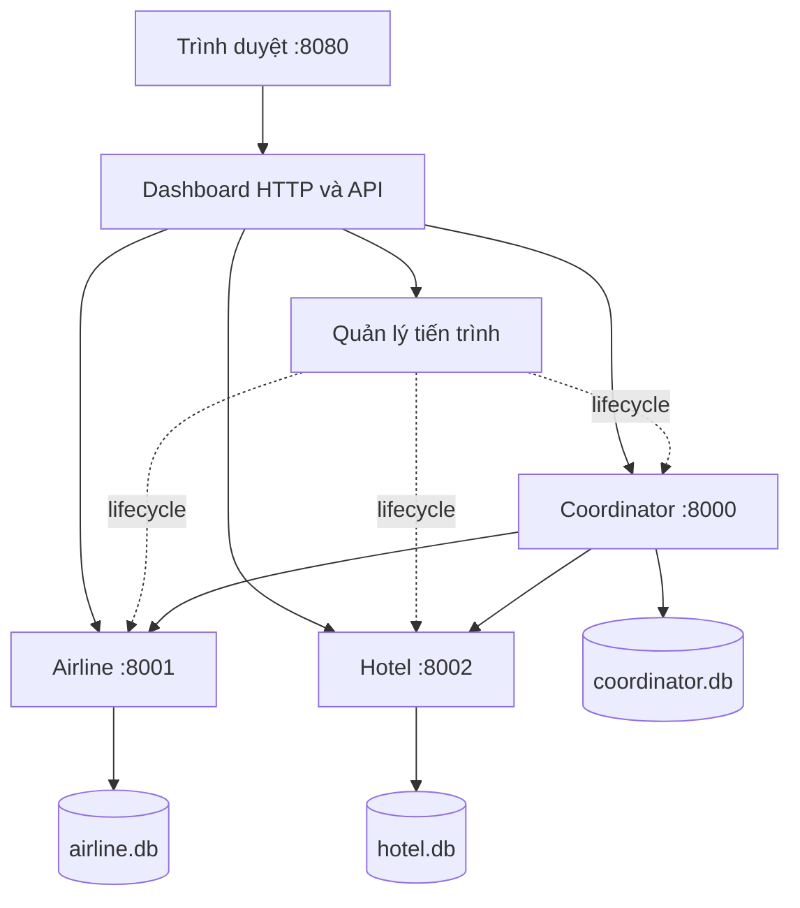

# Đặc tả dashboard web điều khiển và trình diễn 2PC

## 1. Mục tiêu và trạng thái

Dashboard là ứng dụng web cục bộ để nhóm và giảng viên quan sát giao dịch đặt combo một chỗ máy bay và một phòng khách sạn bằng 2PC. Backend/CLI hiện có là nền tảng. Cập nhật 09/11: API độc lập của Khoa đã có entry `run_dashboard_api.py`; UI và process manager thật chưa tích hợp, chưa nghiệm thu dashboard/browser. Phần dưới giữ yêu cầu mục tiêu; xem mục 8 để nối API. Giữ 14 ngày/126 giờ công theo [kế hoạch nhóm](plan.md).

Phạm vi: đặt/retry, tồn kho, giao dịch/ACK/events, gây lỗi, chạy/dừng/khởi động lại ba dịch vụ ngay trên trình duyệt. Đăng nhập khách hàng, thanh toán, lịch bay/ngày nhận phòng và triển khai Internet ngoài bản này.

## 2. Bố cục và hành vi giao diện

Tiếng Việt, nền sáng, chữ/độ tương phản phù hợp trình chiếu. Bố cục ưu tiên laptop từ 1280 px, co thành một cột ở màn hình nhỏ. Trạng thái có chữ đi cùng màu; nút hỗ trợ bàn phím, có chờ/lỗi; polling không làm mất focus hoặc lựa chọn giao dịch.

```text
ĐẶT COMBO DU LỊCH — TRÌNH DIỄN 2PC          Cập nhật lần cuối
[Coordinator: trạng thái + Chạy/Dừng/Khởi động lại]
[Airline: trạng thái + điều khiển] [Hotel: trạng thái + điều khiển]
[Máy bay: tồn / giữ / chưa giữ]    [Phòng: tồn / giữ / chưa giữ]
[Đặt combo: mã yêu cầu, DEFAULT/MISSING, Đặt, Gửi lại]
[Demo: node, điểm crash/delay, kích hoạt, tải đồng thời]
[Bảng giao dịch + bộ lọc]          [Chi tiết giao dịch được chọn]
```

| Khu vực | Dữ liệu và thao tác |
|---|---|
| Dịch vụ | Ba node, trạng thái đang khởi động/đang chạy/đang dừng/đã dừng/bị lỗi. Nút Chạy/Dừng/Khởi động lại theo trạng thái; khóa thao tác lặp khi đang xử lý. Phân biệt child sống với health lỗi. |
| Tồn kho | Hai ô lớn: available là tồn chưa trừ commit; số giữ từ PREPARED/locks; chưa giữ = max(available − số giữ, 0). Do khóa độc quyền theo resource, nếu DEFAULT có lock thì ghi “Tạm khóa — chờ quyết định”; con số chưa giữ không hứa nhận được booking mới. |
| Đặt combo | Airline DEFAULT, Hotel DEFAULT hoặc MISSING; token mới cho yêu cầu mới; hiển thị tx và kết quả. Gửi lại giữ nguyên token/payload. Booking mới sau ABORTED dùng token mới. |
| Giao dịch | tx, token, quyết định Coordinator, trạng thái Airline/Hotel và ACK/2. Lọc tất cả/đang xử lý/commit/abort/chưa đủ xác nhận. |
| Chi tiết | Payload, ACK, reservation, khóa và events từng node. Thứ tự trong node theo seq; không suy diễn thứ tự toàn cục từ timestamp khác node. |
| Demo | Chọn node và điểm lỗi hợp lệ, mode crash/delay, kích hoạt một lần; load mặc định 10 booking/4 worker, có tiến độ và kết quả từng yêu cầu. |

Node không truy cập được: ghi “Không xác định”, lỗi và lần đọc thành công cuối; cache gắn nhãn “Dữ liệu cũ”. Chưa có snapshot thì để chưa có dữ liệu, không thay tồn bằng 0. Các snapshot không phải distributed snapshot nhất quán.

Mất phản hồi booking: “Chưa xác định kết quả — kiểm tra hoặc gửi lại cùng yêu cầu”. COMMITTED/complete=false: “Đã quyết định COMMIT, đang chờ xác nhận”; hoàn tất khi đủ hai ACK. UI/timeout không tự đổi ACTIVE/PREPARING/PREPARED thành ABORTED.

Lưu token/payload của yêu cầu chưa phân giải vào localStorage **trước gửi**, khôi phục sau reload. Không tái dùng token với payload khác. Khóa nút gửi lặp; idempotency backend bảo đảm khi nhiều tab/retry. Không bịa events hoặc làm chậm quyết định cho animation; trạng thái ngắn giữa các lần polling được giải thích qua log thực và fault.

## 3. Kiến trúc dự kiến



HTML/CSS/JavaScript thuần; dashboard Python dùng thư viện chuẩn, không cần Node/npm/framework runtime. Lệnh dự kiến `python run_dashboard.py` phục vụ `http://127.0.0.1:8080`, tự khởi chạy ba dịch vụ bằng cùng interpreter. Dashboard/supervisor nằm ngoài các child nghiệp vụ nên Coordinator chết không kéo sập web. RPC và CLI hiện tại giữ tương thích.

Đọc qua RPC health/snapshot/status, không mở DB nghiệp vụ trực tiếp. Tổng hợp các node song song, timeout đọc 2 giây/node; lỗi từng node không làm mất dữ liệu node khỏe. Poll mỗi giây khi request trước đã hoàn tất để tránh chồng request; trả freshness/lỗi riêng từng node. Cache trong bộ nhớ; dashboard restart đọc lại qua RPC, localStorage giữ yêu cầu chưa rõ kết quả.

## 4. API web dự kiến

JSON; lỗi HTTP dashboard tách khỏi quy ước RPC nghiệp vụ. Dùng 400 đầu vào sai, 404 tên/ID không tồn tại, 409 xung đột/cổng bận, 502/504 lỗi/timeout upstream. Lỗi booking kèm token và `outcome_unknown` khi chưa biết kết quả; không suy quyết định từ HTTP status. Chỉ kết luận tx không tồn tại khi Coordinator truy cập được và trả đúng lỗi đó.

| Phương thức/đường dẫn | Đầu vào | Hành vi tối thiểu |
|---|---|---|
| GET `/api/overview` | Không | Lifecycle/health, tồn/khóa, giao dịch/ACK; snapshot, thời điểm đọc và lỗi riêng từng node |
| POST `/api/bookings` | token, airline, hotel | Begin rồi end cùng payload; trả tx/state/complete/ack; token/resource không rỗng, tối đa 128 ký tự theo backend |
| GET `/api/transactions/{tx}` | tx | Quyết định/ACK, participant/events; unavailable riêng từng node |
| POST `/api/services/{name}/{action}` | Coordinator/Airline/Hotel; start/stop/restart | Lifecycle qua service map cố định; chờ có giới hạn, transitional state qua overview |
| POST `/api/faults` | service, point, mode, seconds nếu delay | Arm hook một lần đúng vai trò; báo lỗi nếu node chưa sẵn sàng |
| POST `/api/load` | count=10, workers=4 mặc định | Trả 202 và run_id; chạy nền với token riêng từng yêu cầu |
| GET `/api/load/{run_id}` | run_id | Tổng/đã xử lý, đang chạy/hoàn tất, kết quả từng token/tx; lỗi mạng vẫn có thể outcome unknown |

Load giới hạn count 1–50, workers 1–8; chỉ một đợt tại một thời điểm, đợt mới khi đang chạy trả 409. Kết quả lưu trong bộ nhớ vòng đời dashboard. Booking upstream chờ tối đa 30 giây; start chờ health tối đa 10 giây, stop chờ tối đa 5 giây rồi kết thúc cưỡng bức đúng child sở hữu.

Fault theo vai trò: Coordinator có after_votes, after_decision, after_ack_airline; RM có before_prepare, after_prepare, before_commit, after_commit. Mode crash/delay, seconds 0–30 theo backend. Một kịch bản chính chỉ arm một lỗi; restart node xóa hook chưa chạy trong bộ nhớ node.

## 5. Quản lý tiến trình

- Chỉ điều khiển child do dashboard tạo bằng Popen; argv/service map cố định, shell=False, root/DB xác định ở server. Không nhận lệnh shell, executable hoặc đường dẫn từ browser.
- Cổng bị chiếm: báo lỗi, không tự sở hữu hoặc giết tiến trình ngoài. Theo dõi child exit và health để tránh coi chương trình ngoài là child vừa tạo.
- Start đang chạy không tạo child mới; stop đã dừng không tác động gì. Tuần tự hóa lifecycle từng node; start/restart hoàn tất khi child sống và health đúng vai trò. Lỗi phải có lý do/log.
- Restart dùng đúng DB cũ. Crash một node không dừng web/hai node kia, không tự restart trước khi người demo quan sát. Lỗi RPC không thoát vòng giám sát.
- stdout/stderr vào log theo dịch vụ, tránh pipe không đọc gây treo. Ctrl+C/đóng chương trình được xử lý bằng cleanup child sở hữu, giữ DB; không hứa cleanup khi OS cưỡng bức hủy supervisor.
- Chỉ bind loopback; kiểm tra Host/Origin cùng nguồn, token phiên cho POST; không CORS mở. Giới hạn này bảo vệ bộ điều khiển demo, không thay đổi RPC nghiệp vụ.
- Không có nút reset DB trong bản đầu. Chuẩn bị sạch bằng dừng dịch vụ và lưu trữ/đổi tên data trước buổi demo; không reset giữa crash/recovery. Không chạy run_demo.py đồng thời vì cùng cổng và script đó dừng cả cụm khi một node chết.

## 6. Kịch bản bảo vệ 12–15 phút

| Bước | Thao tác trên web | Quan sát mong đợi |
|---|---|---|
| 1 | Khởi chạy, giới thiệu | Ba node khỏe, mỗi RM mới có 5 DEFAULT, ba DB riêng |
| 2 | Đặt combo mới | COMMITTED/đủ ACK; tồn 5 → 4 hai bên |
| 3 | Gửi lại, có thể reload trước | Cùng token/tx; tồn vẫn 4 |
| 4 | Yêu cầu mới hotel MISSING | ABORTED, giải phóng khóa, tồn giữ nguyên |
| 5 | Arm Coordinator after_votes/crash, đặt, quan sát rồi Restart | Unknown trên client; hai RM PREPARED giữ khóa; restart từ PREPARING dẫn tới abort và giải phóng khóa |
| 6 | Arm after_decision/crash, đặt rồi Restart | Giữ COMMITTED, replay đủ ACK, tồn mỗi bên 4 → 3 đúng một lần |
| 7 | Load 10 booking/4 worker | UI theo dõi tiến độ; số commit không vượt 3 tài nguyên còn lại; lượng giảm tồn khớp commit |

Khóa độc quyền từ chối khi xung đột nên bước 7 không bắt buộc đúng 3 commit trong mọi lịch chạy; cần chứng minh không oversell. Con số trong bảng là mong đợi trên DB mới, chưa phải kết quả dashboard đã chạy.

Phần bổ sung: Hotel crash after_prepare rồi restart nhận abort; after_commit để mất ACK nhưng không trừ hai lần; before_prepare/delay 3 giây vượt RPC timeout 2 giây, chờ thông điệp muộn và đối chiếu tombstone/locks. Token mới cho yêu cầu mới, retry giữ token gốc; DB luôn giữ nguyên khi phục hồi.

SV1 trình bày quyết định/ACK; SV2 giải thích tồn, ghi tạm, khóa; SV3 thao tác web/retry/fault/load. CLI/terminal dùng đối chiếu và dự phòng, không thay mục tiêu điều khiển toàn bộ qua web.

### Lời dẫn và phân vai cho Khoa

Kịch bản dưới đây để diễn tập W04b cùng W11b, dự kiến 19/11; **chưa chạy** cùng nhóm
hoặc trên máy demo. Lời giải thích được đối chiếu source `0911815a8180ca7fa7ff0fd917eea8c9a21aa527`
và [log backend/API](khoa_test_results.txt) ngày 09/11, Windows/Python 3.11.15.
Khoa giữ nhịp và giải thích giao thức; Khánh thao tác UI; Hữu theo dõi child/DB/khóa.
Trước diễn tập, nhóm phải ghi commit tích hợp/Python/Chrome hoặc Edge và hoàn thành
kiểm chứng UI/manager tương ứng; source baseline hiện chỉ có entry API độc lập.

| Thời gian | Phần Khoa trình bày | Dữ liệu nhóm phải chỉ ra |
|---|---|---|
| 0:00–1:30 | “Mỗi combo cần một chỗ máy bay và một phòng ở hai tiến trình, mỗi bên có DB riêng. Coordinator điều phối hai pha để hai tài nguyên nhận cùng quyết định cuối.” Nêu mô hình lỗi crash/recovery, không có thanh toán thật | Khánh chỉ ba node/health, Hữu chỉ ba DB riêng. Tồn ban đầu của một buổi demo sạch là 5/5 |
| 1:30–3:30 | “Pha 1 hỏi các bên có thể giữ tài nguyên không; YES chỉ gửi sau PREPARED/khóa đã bền. Pha 2 phát quyết định đã ghi bền.” Sau đặt thành công: “COMMITTED là quyết định; complete xác nhận đủ hai ACK.” Retry: “Giữ token và payload, nên lấy lại tx cũ.” | Khánh đặt, ghi token/tx/payload, quan sát ACK/2 và tồn 4/4; retry/reload giữ cùng yêu cầu. Hữu đối chiếu một lần giảm tồn |
| 3:30–4:30 | “Hotel MISSING không thể vote YES, nên quyết định là ABORT. Chỗ máy bay mới chỉ được giữ tạm phải được giải phóng.” | Yêu cầu mới/token mới; ABORTED, đủ ACK, khóa của tx đã xóa; tồn vẫn 4/4 |
| 4:30–7:30 | “Coordinator chết sau vote, trước quyết định: hai RM vẫn PREPARED. Chúng không được tự bỏ khóa theo timeout vì chưa biết quyết định. Đây là tính blocking của 2PC.” Sau restart: “Coordinator đọc nhật ký thấy chưa có quyết định cuối và ghi ABORT, rồi replay.” | Khánh arm after_votes/crash và đặt; UI ghi unknown, web/hai RM vẫn sống. Hữu chỉ PREPARED/locks từ snapshot mới; restart đúng Coordinator, giữ DB. Cuối cùng ABORTED/đủ ACK, tồn 4/4 |
| 7:30–10:30 | “Lần này hook chạy sau khi quyết định COMMIT đã được ghi bền. Sau restart phải tiếp tục COMMIT; không được chuyển abort vì client bị timeout.” Nêu khả năng mất ACK và replay idempotent | Khánh arm after_decision/crash với token mới, đặt, restart cùng DB và retry đúng payload. Khi Coordinator đang chết, UI vẫn unknown; sau phục hồi thấy COMMITTED/đủ ACK, tồn 3/3 đúng một lần |
| 10:30–12:30 | “Load gửi 10 booking với 4 worker. Chỉ chấp nhận tối đa lượng tồn còn; số commit thực tế phải đối chiếu, không hứa luôn đúng ba. Kết quả mạng unknown phải được kiểm tra trước khi tổng kết.” | Khánh chỉ run_id/tiến độ/từng token. Khoa đối chiếu số commit và tồn sau; Hữu kiểm tra không oversell/khóa còn lại, không suy abort từ HTTP lỗi |
| 12:30–13:30 | “Bản học thuật dùng một Coordinator, đĩa bền và giả định kết nối hồi phục; chưa có HA hay xử lý mất DB vĩnh viễn. Test tự động chứng minh phần backend/API; browser và vận hành phải có bằng chứng riêng trên bản tích hợp.” | Chỉ commit/log/CI đúng source đang demo; ghi hạn chế thực tế. Dành phần còn lại đến 15:00 cho câu hỏi |

Khoa không đọc toàn bộ events thành một timeline toàn cục: chọn seq theo từng node để
giải thích prepare → quyết định → effect/replay. Nếu polling bỏ qua trạng thái ngắn,
dùng log thật hoặc fault để quan sát; không chèn trạng thái/animation giả vào kết quả.

### Chuẩn bị và xử lý khi demo không theo kỳ vọng

- Trước buổi chạy: ghi commit, phiên bản môi trường, cổng/DB và số tồn ban đầu. Dừng
  các dịch vụ cũ; nếu cần DB sạch thì lưu trữ/đổi tên data trước buổi demo. Không chạy
  `run_demo.py` đồng thời với supervisor. Kiểm tra manager sở hữu đúng child và web
  vẫn sống qua một node crash trước khi trình bày.
- Mỗi bước chỉ arm một lỗi; yêu cầu mới dùng token mới, retry giữ nguyên token/payload.
  Sau crash/restart luôn dùng DB cũ. Hook chưa kích hoạt bị mất khi node restart;
  ghi nhận hook đã arm/đã chạy từ bằng chứng, không suy từ thao tác bấm nút.
- Nếu thiếu phản hồi: đọc “Chưa xác định kết quả”, giữ yêu cầu cũ, kiểm tra trạng thái
  rồi retry đúng payload. Không chuyển sang token mới chỉ để được thông báo thành công.
- Nếu thấy COMMITTED nhưng chưa đủ ACK: giải thích đang chờ xác nhận; Hữu kiểm tra RM
  lỗi và restart đúng child, Khoa theo dõi replay. Không abort hoặc trừ tồn thủ công.
- Nếu cổng bận/manager không sở hữu child: dừng kịch bản, ghi lỗi/owner; không kill tiến
  trình ngoài. Nếu chỉ có CLI/API dùng làm dự phòng thì nói rõ phạm vi đã chạy; phần
  lifecycle/web tiếp tục ghi **chưa chạy**, không chốt M1/M2 bằng demo dự phòng.
- Nếu thời gian vượt 15 phút: giữ hai ca crash chính; ca Hotel after_commit hoặc delay
  là bổ sung theo câu hỏi. Không bỏ bước kiểm tra quyết định/ACK/tồn sau recovery.
  Biên bản ghi bước chưa chạy và người phụ trách; không ghi diễn tập đạt từ kịch bản này.

### Câu hỏi phản biện và ý trả lời của Khoa

| Câu hỏi | Ý trả lời dựa trên bản triển khai |
|---|---|
| Tại sao cần hai pha? | Prepare ghi giữ tài nguyên bền trước khi vote YES; Coordinator chỉ COMMIT khi đủ YES rồi ghi quyết định trước pha 2. Một lần gửi commit đơn lẻ không cung cấp bước giữ tài nguyên ở cả hai RM |
| 2PC có luôn tiến triển khi một bên chết không? | Không. PREPARED có thể blocking đến khi nhận quyết định. Bản này không có HA/peer termination; tiến triển dựa vào phục hồi đúng DB và kết nối trở lại |
| Timeout có nghĩa giao dịch thất bại không? | Không. Có thể effect/quyết định đã bền nhưng phản hồi mất; API ghi outcome_unknown. Giữ token/payload, kiểm tra/retry; chỉ trạng thái cuối đã đọc được mới cho phép kết luận |
| COMMITTED khác complete như thế nào? | COMMITTED là quyết định đã bền; complete=true khi ACK của Airline và Hotel đều đã ghi. Thiếu ACK vẫn giữ quyết định COMMIT và replay |
| Mất ACK rồi gửi COMMIT lại có trừ tồn hai lần? | RM ghi effect/trạng thái/xóa khóa/event nguyên tử. Lần gửi lại thấy COMMITTED và trả kết quả cũ; không chạy cập nhật tồn lần hai |
| Vì sao PREPARED không tự hết hạn? | Khi mất Coordinator, RM không biết COMMIT đã được ghi ở nơi khác chưa. Tự abort có thể tạo quyết định cuối đối nghịch; phải chờ quyết định hợp lệ |
| Coordinator khởi động lại quyết định theo cách nào? | ACTIVE/PREPARING chưa có quyết định được ghi ABORTED; COMMITTED/ABORTED có sẵn giữ nguyên và phát lại tới RM thiếu ACK. Không bốc thăm hoặc quyết định theo timeout UI |
| PREPARE tới muộn có tạo khóa sau abort không? | ABORT ghi tombstone ngay cả khi chưa thấy prepare. Lần prepare cùng tx đọc ABORTED, vote không đồng ý và không tạo khóa |
| Token phiên có thay booking token không? | Không. Token phiên gắn với HTTP server và được lấy lại sau web restart. Booking token/payload gắn yêu cầu nghiệp vụ và phải giữ nguyên; token cũ khác payload trả conflict |
| Hai tab có bảo đảm exactly-once không? | UNIQUE token và replay idempotent bảo vệ effect cho cùng token/payload với DB giữ nguyên. Hai token khác nhau là hai yêu cầu; chưa có thanh toán thật nên không khẳng định exactly-once cho ngân hàng |
| Có thể gộp timestamps để chứng minh thứ tự toàn cục? | Không. Snapshot ở các node được đọc riêng, cache có thể stale; dùng seq từng node và liên kết bằng tx. Lần đọc không liên lạc được không được hiển thị tồn 0 |
| Vì sao load có thể abort khi vẫn còn tồn? | RM từ chối ngay khi resource đang có khóa độc quyền; không có hàng đợi công bằng. Cần chứng minh không oversell và effect khớp số commit đã phân giải, không hứa một số commit cố định |
| Bộ test đã chứng minh dashboard hoàn chỉnh chưa? | Chỉ nêu đúng commit/môi trường/test đã chạy. Child RPC và manager double không thay bằng chứng manager thật, UI, Chrome/Edge và máy demo; các ca đó vẫn cần owner nghiệm thu |

Sau diễn tập, Khoa ghi thời lượng, commit, ca đã chạy/chưa chạy, log/ảnh và lỗi có owner/hạn
vào #11; Khánh bàn giao bằng chứng W11b, Hữu xác nhận phần dữ liệu/lifecycle. Chỉ chốt
bản nộp sau kiểm tra lại các ca bị ảnh hưởng bởi sửa lỗi và đối chiếu báo cáo/source.

## 7. Kiểm thử và nghiệm thu

Giữ 14 test backend. Bổ sung test API với lỗi node từng phần, timeout, retry và load; test process manager với child thật, cổng bị chiếm, lifecycle lặp, restart giữ DB và cleanup đúng ownership. Dùng data tạm/cổng riêng để không tác động dữ liệu demo.

- [ ] Đặt/abort, lọc và chi tiết lấy dữ liệu thật.
- [ ] Double-click, nhiều tab, retry và reload không đặt trùng; payload cũ giữ nguyên.
- [ ] Web hoạt động khi Coordinator/Hotel chết; restart đúng node qua UI.
- [ ] PREPARED/khóa giữ qua crash; COMMIT chờ ACK khác hoàn tất; lỗi mạng là unknown.
- [ ] Stale/unknown không thành tồn 0; freshness riêng từng node.
- [ ] Load chạy nền, UI không khóa; validation count/workers/đợt chạy hoạt động.
- [ ] Cổng bận, đầu vào sai, yêu cầu trái nguồn được xử lý; không tác động tiến trình ngoài.
- [ ] Chrome/Edge trên máy demo, bàn phím/nhãn chữ/focus/presentation hoạt động.
- [ ] Chạy đủ demo, lưu commit/Python/browser, log và ảnh thực tế.

Chỉ ghi hoàn thành sau khi tác giả tự kiểm tra, xử lý góp ý nếu có, kiểm thử phù hợp đạt, tài liệu khớp hành vi và cả ba giải thích được phần sở hữu. Review chéo được khuyến khích; không bắt buộc người khác Approve để merge PR. Không ghi dự đoán thành kết quả thực nghiệm.

## 8. Contract bàn giao W01 — 09/11/2026

Đây là contract kỹ thuật để triển khai W02/W06/W09, chưa xác nhận Hữu/Khánh đã nhận hoặc đồng thuận. Tên node trên wire luôn là `coordinator`, `airline`, `hotel` (chữ thường). RPC/backend hiện có giữ nguyên. Frontend chỉ gọi API cùng nguồn.

### Phiên và HTTP

`GET /api/session` trả `{"session_token":"<random>"}`. Mỗi vòng đời HTTP server tạo token ngẫu nhiên; frontend giữ trong bộ nhớ và gửi header `X-Session-Token` trên mọi POST. Sau khi dashboard restart, lấy token mới trước khi gửi lại **cùng booking token/payload**. Token phiên không phải booking token.

Server chỉ bind `127.0.0.1`; Host phải đúng host/port server (`127.0.0.1` hoặc `localhost`). Nếu Origin hiện diện, phải trùng origin của Host. Không bật CORS. Sai Host/Origin/token phiên trả 403 trước khi chạy thao tác. JSON phải là object; request tối đa 64 KiB. Không nhận URL RPC, executable, command, DB path hoặc service name tùy ý từ browser.

Lỗi JSON dạng `{"error":{"code":"invalid_input","message":"..."}}`. Booking đã gửi upstream nhưng không lấy được kết quả kèm `token`, `payload`, `tx` nếu đã biết và `outcome_unknown:true`; không bịa `state`. Timeout trả 504, lỗi kết nối/protocol upstream 502. Input sai 400; token khác payload 409; ID/tên không tồn tại 404 chỉ khi xác minh được. Trong lúc chưa nối manager, endpoint lifecycle trả 503 `lifecycle_unavailable`, không tác động node bên ngoài.

### Overview và chi tiết

Mỗi node là một envelope có `health`, `snapshot`, `last_success_at` (UTC ISO-8601 hoặc null), `stale`, `error` (null hoặc code/message) và `lifecycle`. Cache chỉ cập nhật khi đọc health/snapshot hợp lệ; lỗi giữ snapshot trước, `stale:true`; chưa từng đọc được thì snapshot null. Một lần đọc health + snapshot dùng chung ngân sách 2 giây/node, ba node đọc song song. Không dùng timestamp khác node để sắp xếp một lịch sử toàn cục.

Ví dụ một phần `GET /api/overview`:

```json
{
  "nodes": {
    "coordinator": {
      "health": {"ok": true, "role": "coordinator"},
      "snapshot": {"transactions": [], "events": []},
      "last_success_at": "2026-11-09T08:00:00Z",
      "stale": false,
      "error": null,
      "lifecycle": {"state": "unmanaged", "managed": false}
    }
  }
}
```

Kết quả thực luôn có đủ ba key node. Coordinator snapshot chuyển `payload` từ JSON string thành object, `ack` thành list và thêm `complete` (đủ hai ACK). Participant giữ `inventory`, `reservations`, `locks`, `events` từ RPC. UI tự tính số giữ theo reservations PREPARED, hiển thị khóa riêng; không suy số giữ bằng toàn bộ available.

`GET /api/transactions/{tx}` trả `{"tx":"...","nodes":{...},"transaction":{...}}`. Envelopes như overview nhưng snapshot lọc theo tx (participant vẫn có inventory, chỉ giữ reservation/lock/events đúng tx). `transaction` là bản ghi Coordinator đã chuẩn hóa hoặc null. 404 chỉ khi snapshot Coordinator mới đọc thành công và xác nhận không có tx; Coordinator không đọc được trả 502/504 kèm dữ liệu từng node, kể cả participant còn PREPARED. Dữ liệu Coordinator cũ chỉ là stale, không chứng minh quyết định hiện tại.

### Booking, fault và load

`POST /api/bookings` nhận đủ ba string không rỗng, tối đa 128 ký tự:

```json
{"token":"booking-001","airline":"DEFAULT","hotel":"DEFAULT"}
```

Begin rồi end dùng **một deadline tổng 30 giây**. Kết quả 200 là bản ghi Coordinator có token/tx/payload/state/ack/complete. ABORTED hợp lệ vẫn là 200, không phải lỗi HTTP. Cùng token/payload trả lại cùng tx; khác payload trả 409. Không tự động retry một yêu cầu bằng token mới.

`POST /api/faults`: `{"service":"coordinator","point":"after_decision","mode":"crash"}` hoặc delay kèm `seconds` hữu hạn 0–30. Kiểm tra whitelist theo vai trò trước RPC; trả kết quả `armed` của backend. UI chỉ arm một lỗi cho mỗi kịch bản chính.

`POST /api/load`: `{"count":10,"workers":4}`; chỉ nhận số nguyên (không nhận bool), count 1–50/workers 1–8. Trả 202 `{"run_id":"..."}`. `GET /api/load/{run_id}` trả run_id, state (`running`/`complete`), count, workers, processed và results. Mỗi result có token, `result` hoặc `error`/`outcome_unknown`; lỗi một request không dừng cả đợt. 409 khi đợt trước đang chạy. Token riêng từng request; payload dùng DEFAULT/DEFAULT. Giữ tối đa 20 đợt trong bộ nhớ, loại đợt hoàn tất cũ nhất; ID không còn trả 404. Không có bảo đảm lưu load qua restart.

### Interface process manager bàn giao cho Hữu

Khoa cung cấp `LifecycleManager` Protocol; Hữu cung cấp implementation và truyền vào HTTP server:

```python
def snapshot(self) -> dict[str, dict]: ...
def control(self, name: str, action: str) -> dict: ...
```

`snapshot()` trả đủ ba node, mỗi node có tối thiểu state, managed, pid (hoặc null), error (hoặc null). State: starting/running/stopping/stopped/failed. Phải trả nhanh để overview đọc khi start/stop đang chờ. `control()` nhận service map cố định và start/stop/restart; tự đảm bảo khóa từng node, timeout 10/5 giây, child ownership, DB cũ, log và cleanup. Trả lifecycle record khi hoàn tất; ném `LifecycleError(status, code, message)` cho lỗi dự kiến (409 cổng bận/xung đột, 504 timeout, 502 child lỗi). Manager giữ trách nhiệm cleanup trong entrypoint sở hữu child.

API khi không có implementation dùng `unmanaged`, không giả định RPC khỏe đồng nghĩa child thuộc dashboard. Kiểm thử API dùng manager double chỉ chứng minh hợp đồng adapter; W07 phải có child thật. Entry `run_dashboard_api.py` chạy API độc lập, không phải lệnh `run_dashboard.py`/dashboard đầy đủ của M1.

### Bàn giao, trạng thái và lịch bù

- Khoa: W01 contract và W02 API. Hữu: W05 xác nhận dữ liệu/khóa, W06 manager, W07 child thật. Khánh: W09 UI/token, W10 browser.
- Giữ hạn gốc W01 08/11, dự báo toàn phần mới 10/11; overview thật dự báo bù ban đầu 10/11 và đã kiểm chứng qua API ngày 09/11. M1 13/11 vẫn là mục tiêu có điều kiện theo đầu vào thật, không tự đổi deadline.
- Cần Hữu xác nhận interface/ownership và Khánh xác nhận envelope/session trước khi W01 nghiệm thu toàn phần. Thiếu xác nhận được ghi là pending, không đóng issue để lấy tiến độ.
- CI backend baseline `d3c39e7` đã đạt bốn job; lần kiểm chứng local mới phải ghi riêng môi trường/kết quả. Kiểm thử API/lifecycle/browser chưa được suy từ backend baseline.
