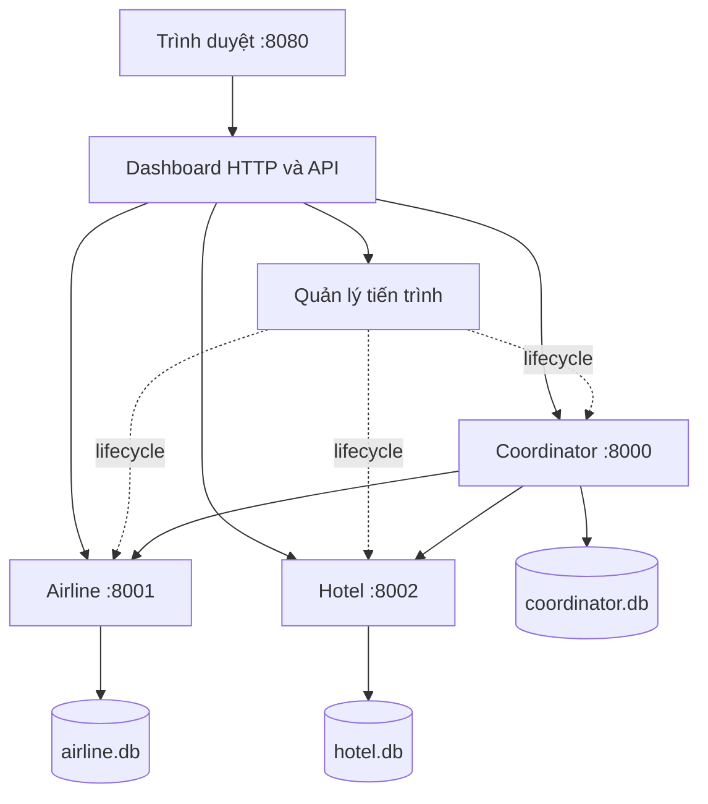

# Đặc tả dashboard web điều khiển và trình diễn 2PC

## 1. Mục tiêu và trạng thái

Dashboard là ứng dụng web cục bộ **sẽ xây dựng** để nhóm và giảng viên quan sát giao dịch đặt combo một chỗ máy bay và một phòng khách sạn bằng 2PC. Backend/CLI hiện có là nền tảng; tài liệu này không xác nhận giao diện hoặc API web đã được triển khai. Giữ 14 ngày/126 giờ công theo [kế hoạch nhóm](plan.md).

Phạm vi: đặt/retry, tồn kho, giao dịch/ACK/events, gây lỗi, chạy/dừng/khởi động lại ba dịch vụ ngay trên trình duyệt. Đăng nhập khách hàng, thanh toán, lịch bay/ngày nhận phòng và triển khai Internet ngoài bản này.

## 2. Bố cục và hành vi giao diện

Tiếng Việt, nền sáng, chữ/độ tương phản phù hợp trình chiếu. Bố cục ưu tiên laptop từ 1280 px, co thành một cột ở màn hình nhỏ. Trạng thái có chữ đi cùng màu; nút hỗ trợ bàn phím, có chờ/lỗi; polling không làm mất focus hoặc lựa chọn giao dịch.

```text
ĐẶT COMBO DU LỊCH — TRÌNH DIỄN 2PC          Cập nhật lần cuối
[Coordinator: trạng thái + Chạy/Dừng/Khởi động lại]
[Airline: trạng thái + điều khiển] [Hotel: trạng thái + điều khiển]
[Máy bay: tồn / giữ / chưa giữ]    [Phòng: tồn / giữ / chưa giữ]
[Đặt combo: mã yêu cầu, DEFAULT/MISSING, Đặt, Gửi lại]
[Demo: node, điểm crash/delay, kích hoạt, tải đồng thời]
[Bảng giao dịch + bộ lọc]          [Chi tiết giao dịch được chọn]
```

| Khu vực | Dữ liệu và thao tác |
|---|---|
| Dịch vụ | Ba node, trạng thái đang khởi động/đang chạy/đang dừng/đã dừng/bị lỗi. Nút Chạy/Dừng/Khởi động lại theo trạng thái; khóa thao tác lặp khi đang xử lý. Phân biệt child sống với health lỗi. |
| Tồn kho | Hai ô lớn: available là tồn chưa trừ commit; số giữ từ PREPARED/locks; chưa giữ = max(available − số giữ, 0). Do khóa độc quyền theo resource, nếu DEFAULT có lock thì ghi “Tạm khóa — chờ quyết định”; con số chưa giữ không hứa nhận được booking mới. |
| Đặt combo | Airline DEFAULT, Hotel DEFAULT hoặc MISSING; token mới cho yêu cầu mới; hiển thị tx và kết quả. Gửi lại giữ nguyên token/payload. Booking mới sau ABORTED dùng token mới. |
| Giao dịch | tx, token, quyết định Coordinator, trạng thái Airline/Hotel và ACK/2. Lọc tất cả/đang xử lý/commit/abort/chưa đủ xác nhận. |
| Chi tiết | Payload, ACK, reservation, khóa và events từng node. Thứ tự trong node theo seq; không suy diễn thứ tự toàn cục từ timestamp khác node. |
| Demo | Chọn node và điểm lỗi hợp lệ, mode crash/delay, kích hoạt một lần; load mặc định 10 booking/4 worker, có tiến độ và kết quả từng yêu cầu. |

Node không truy cập được: ghi “Không xác định”, lỗi và lần đọc thành công cuối; cache gắn nhãn “Dữ liệu cũ”. Chưa có snapshot thì để chưa có dữ liệu, không thay tồn bằng 0. Các snapshot không phải distributed snapshot nhất quán.

Mất phản hồi booking: “Chưa xác định kết quả — kiểm tra hoặc gửi lại cùng yêu cầu”. COMMITTED/complete=false: “Đã quyết định COMMIT, đang chờ xác nhận”; hoàn tất khi đủ hai ACK. UI/timeout không tự đổi ACTIVE/PREPARING/PREPARED thành ABORTED.

Lưu token/payload của yêu cầu chưa phân giải vào localStorage **trước gửi**, khôi phục sau reload. Không tái dùng token với payload khác. Khóa nút gửi lặp; idempotency backend bảo đảm khi nhiều tab/retry. Không bịa events hoặc làm chậm quyết định cho animation; trạng thái ngắn giữa các lần polling được giải thích qua log thực và fault.

## 3. Kiến trúc dự kiến



HTML/CSS/JavaScript thuần; dashboard Python dùng thư viện chuẩn, không cần Node/npm/framework runtime. Lệnh dự kiến `python run_dashboard.py` phục vụ `http://127.0.0.1:8080`, tự khởi chạy ba dịch vụ bằng cùng interpreter. Dashboard/supervisor nằm ngoài các child nghiệp vụ nên Coordinator chết không kéo sập web. RPC và CLI hiện tại giữ tương thích.

Đọc qua RPC health/snapshot/status, không mở DB nghiệp vụ trực tiếp. Tổng hợp các node song song, timeout đọc 2 giây/node; lỗi từng node không làm mất dữ liệu node khỏe. Poll mỗi giây khi request trước đã hoàn tất để tránh chồng request; trả freshness/lỗi riêng từng node. Cache trong bộ nhớ; dashboard restart đọc lại qua RPC, localStorage giữ yêu cầu chưa rõ kết quả.

## 4. API web dự kiến

JSON; lỗi HTTP dashboard tách khỏi quy ước RPC nghiệp vụ. Dùng 400 đầu vào sai, 404 tên/ID không tồn tại, 409 xung đột/cổng bận, 502/504 lỗi/timeout upstream. Lỗi booking kèm token và `outcome_unknown` khi chưa biết kết quả; không suy quyết định từ HTTP status. Chỉ kết luận tx không tồn tại khi Coordinator truy cập được và trả đúng lỗi đó.

| Phương thức/đường dẫn | Đầu vào | Hành vi tối thiểu |
|---|---|---|
| GET `/api/overview` | Không | Lifecycle/health, tồn/khóa, giao dịch/ACK; snapshot, thời điểm đọc và lỗi riêng từng node |
| POST `/api/bookings` | token, airline, hotel | Begin rồi end cùng payload; trả tx/state/complete/ack; token/resource không rỗng, tối đa 128 ký tự theo backend |
| GET `/api/transactions/{tx}` | tx | Quyết định/ACK, participant/events; unavailable riêng từng node |
| POST `/api/services/{name}/{action}` | Coordinator/Airline/Hotel; start/stop/restart | Lifecycle qua service map cố định; chờ có giới hạn, transitional state qua overview |
| POST `/api/faults` | service, point, mode, seconds nếu delay | Arm hook một lần đúng vai trò; báo lỗi nếu node chưa sẵn sàng |
| POST `/api/load` | count=10, workers=4 mặc định | Trả 202 và run_id; chạy nền với token riêng từng yêu cầu |
| GET `/api/load/{run_id}` | run_id | Tổng/đã xử lý, đang chạy/hoàn tất, kết quả từng token/tx; lỗi mạng vẫn có thể outcome unknown |

Load giới hạn count 1–50, workers 1–8; chỉ một đợt tại một thời điểm, đợt mới khi đang chạy trả 409. Kết quả lưu trong bộ nhớ vòng đời dashboard. Booking upstream chờ tối đa 30 giây; start chờ health tối đa 10 giây, stop chờ tối đa 5 giây rồi kết thúc cưỡng bức đúng child sở hữu.

Fault theo vai trò: Coordinator có after_votes, after_decision, after_ack_airline; RM có before_prepare, after_prepare, before_commit, after_commit. Mode crash/delay, seconds 0–30 theo backend. Một kịch bản chính chỉ arm một lỗi; restart node xóa hook chưa chạy trong bộ nhớ node.

## 5. Quản lý tiến trình

- Chỉ điều khiển child do dashboard tạo bằng Popen; argv/service map cố định, shell=False, root/DB xác định ở server. Không nhận lệnh shell, executable hoặc đường dẫn từ browser.
- Cổng bị chiếm: báo lỗi, không tự sở hữu hoặc giết tiến trình ngoài. Theo dõi child exit và health để tránh coi chương trình ngoài là child vừa tạo.
- Start đang chạy không tạo child mới; stop đã dừng không tác động gì. Tuần tự hóa lifecycle từng node; start/restart hoàn tất khi child sống và health đúng vai trò. Lỗi phải có lý do/log.
- Restart dùng đúng DB cũ. Crash một node không dừng web/hai node kia, không tự restart trước khi người demo quan sát. Lỗi RPC không thoát vòng giám sát.
- stdout/stderr vào log theo dịch vụ, tránh pipe không đọc gây treo. Ctrl+C/đóng chương trình được xử lý bằng cleanup child sở hữu, giữ DB; không hứa cleanup khi OS cưỡng bức hủy supervisor.
- Chỉ bind loopback; kiểm tra Host/Origin cùng nguồn, token phiên cho POST; không CORS mở. Giới hạn này bảo vệ bộ điều khiển demo, không thay đổi RPC nghiệp vụ.
- Không có nút reset DB trong bản đầu. Chuẩn bị sạch bằng dừng dịch vụ và lưu trữ/đổi tên data trước buổi demo; không reset giữa crash/recovery. Không chạy run_demo.py đồng thời vì cùng cổng và script đó dừng cả cụm khi một node chết.

## 6. Kịch bản bảo vệ 12–15 phút

| Bước | Thao tác trên web | Quan sát mong đợi |
|---|---|---|
| 1 | Khởi chạy, giới thiệu | Ba node khỏe, mỗi RM mới có 5 DEFAULT, ba DB riêng |
| 2 | Đặt combo mới | COMMITTED/đủ ACK; tồn 5 → 4 hai bên |
| 3 | Gửi lại, có thể reload trước | Cùng token/tx; tồn vẫn 4 |
| 4 | Yêu cầu mới hotel MISSING | ABORTED, giải phóng khóa, tồn giữ nguyên |
| 5 | Arm Coordinator after_votes/crash, đặt, quan sát rồi Restart | Unknown trên client; hai RM PREPARED giữ khóa; restart từ PREPARING dẫn tới abort và giải phóng khóa |
| 6 | Arm after_decision/crash, đặt rồi Restart | Giữ COMMITTED, replay đủ ACK, tồn mỗi bên 4 → 3 đúng một lần |
| 7 | Load 10 booking/4 worker | UI theo dõi tiến độ; số commit không vượt 3 tài nguyên còn lại; lượng giảm tồn khớp commit |

Khóa độc quyền từ chối khi xung đột nên bước 7 không bắt buộc đúng 3 commit trong mọi lịch chạy; cần chứng minh không oversell. Con số trong bảng là mong đợi trên DB mới, chưa phải kết quả dashboard đã chạy.

Phần bổ sung: Hotel crash after_prepare rồi restart nhận abort; after_commit để mất ACK nhưng không trừ hai lần; before_prepare/delay 3 giây vượt RPC timeout 2 giây, chờ thông điệp muộn và đối chiếu tombstone/locks. Token mới cho yêu cầu mới, retry giữ token gốc; DB luôn giữ nguyên khi phục hồi.

SV1 trình bày quyết định/ACK; SV2 giải thích tồn, ghi tạm, khóa; SV3 thao tác web/retry/fault/load. CLI/terminal dùng đối chiếu và dự phòng, không thay mục tiêu điều khiển toàn bộ qua web.

## 7. Kiểm thử và nghiệm thu

Giữ 14 test backend. Bổ sung test API với lỗi node từng phần, timeout, retry và load; test process manager với child thật, cổng bị chiếm, lifecycle lặp, restart giữ DB và cleanup đúng ownership. Dùng data tạm/cổng riêng để không tác động dữ liệu demo.

- [ ] Đặt/abort, lọc và chi tiết lấy dữ liệu thật.
- [ ] Double-click, nhiều tab, retry và reload không đặt trùng; payload cũ giữ nguyên.
- [ ] Web hoạt động khi Coordinator/Hotel chết; restart đúng node qua UI.
- [ ] PREPARED/khóa giữ qua crash; COMMIT chờ ACK khác hoàn tất; lỗi mạng là unknown.
- [ ] Stale/unknown không thành tồn 0; freshness riêng từng node.
- [ ] Load chạy nền, UI không khóa; validation count/workers/đợt chạy hoạt động.
- [ ] Cổng bận, đầu vào sai, yêu cầu trái nguồn được xử lý; không tác động tiến trình ngoài.
- [ ] Chrome/Edge trên máy demo, bàn phím/nhãn chữ/focus/presentation hoạt động.
- [ ] Chạy đủ demo, lưu commit/Python/browser, log và ảnh thực tế.

Chỉ ghi hoàn thành sau khi tác giả tự kiểm tra, xử lý góp ý nếu có, kiểm thử phù hợp đạt, tài liệu khớp hành vi và cả ba giải thích được phần sở hữu. Review chéo được khuyến khích; không bắt buộc người khác Approve để merge PR. Không ghi dự đoán thành kết quả thực nghiệm.
