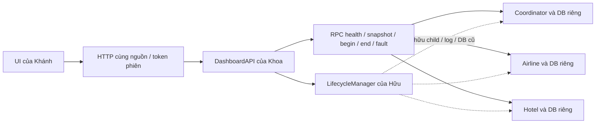

# Bàn giao phần của Khoa — API và kiểm soát tích hợp

Ngày cập nhật: 09/11/2026, Asia/Saigon. Tổng baseline của Khoa 42h, nhóm 126h;
đây là effort kế hoạch, không phải giờ đã tiêu. D1 = 07/11, D14 = 20/11.

## Kiến trúc và trách nhiệm

API dùng thư viện Python chuẩn, chạy ngoài Coordinator. HTTP server chỉ bind loopback;
POST kiểm tra Host/Origin/token phiên. Backend hiện có vẫn chịu quyết định 2PC, persistence,
idempotency và replay; API không tự ghi DB hoặc tự quyết định abort khi mất kết nối.

Snapshot Coordinator có payload/ack dạng JSON string: API chuẩn hóa object/list và tính
complete từ ACK của airline/hotel. Node được đọc song song, health/snapshot dùng chung
deadline 2 giây/node. Cache theo node có freshness; dữ liệu cũ không chứng minh trạng thái
hiện tại. Participant PREPARED giữ khóa qua restart; COMMIT thiếu ACK vẫn là quyết định
bền vững, phải replay đến đủ ACK. Timestamp chỉ để quan sát, events có thứ tự riêng mỗi node.

Booking begin/end dùng chung deadline 30 giây. Khi đã gửi nhưng không có kết quả xác định,
lỗi API giữ token/payload và tx đã biết, outcome_unknown=true; retry dùng đúng yêu cầu cũ.
Không có token mới tự sinh cho retry. Token phiên chỉ bảo vệ thao tác HTTP cùng nguồn.

Load là công việc nền trong một dashboard process: một đợt, 1–50 request, 1–8 worker,
token riêng mỗi request, kết quả theo request. Giữ tối đa 20 đợt; không có lưu bền qua restart.
Lỗi mạng trong một request vẫn có thể chưa xác định, không tính tự động là abort.

Interface, JSON và lỗi chi tiết nằm trong [đặc tả, mục 8](DASHBOARD_SPEC.md).

## Nội dung báo cáo kỹ thuật của Khoa

Phần này dành cho ghép báo cáo W04a: giải thích source đã triển khai, các bất biến và
giới hạn có bằng chứng. Source đối chiếu là `0911815a8180ca7fa7ff0fd917eea8c9a21aa527`;
phần mở rộng HTTP ở nhánh độc lập được ghi riêng bên dưới. Báo cáo đầy đủ vẫn cần W08
của Hữu, W11a của Khánh và thông tin học phần được nhóm xác nhận.

### Đơn vị giao dịch và luồng xử lý

Một yêu cầu đặt combo lấy đúng một DEFAULT ở Airline và một tài nguyên Hotel do người
dùng chọn. Booking token định danh yêu cầu nghiệp vụ; tx là UUID do Coordinator tạo.
HTTP session token bảo vệ POST trong vòng đời dashboard, có thể đổi khi web restart,
trong khi booking token/payload phải giữ nguyên để retry.

1. `DashboardAPI.book()` kiểm tra đủ token/airline/hotel, gọi `begin` rồi `end` trong
   cùng ngân sách tối đa 30 giây. API gọi RPC, không mở SQLite nghiệp vụ trực tiếp.
2. `Coordinator.handle('begin')` ghi payload đã chuẩn hóa và trạng thái ACTIVE. Ràng
   buộc UNIQUE của token ngăn tạo tx thứ hai. Cùng token/cùng payload trả tx cũ;
   khác payload bị từ chối và API ánh xạ thành 409 `token_conflict`.
3. `end` chuyển PREPARING rồi gửi prepare tới Airline/Hotel. Participant chỉ vote YES
   sau khi ghi PREPARED, reservation và khóa độc quyền trong cùng local transaction.
   Hết chỗ, thiếu resource, khóa xung đột hoặc lỗi RPC dẫn đến không đủ hai phiếu YES.
4. Coordinator ghi COMMITTED khi cả hai vote YES, còn lại ghi ABORTED. Ghi quyết định
   và event hoàn tất trong SQLite trước khi phát thông điệp commit/abort của pha 2.
5. Coordinator gửi quyết định tới từng RM chưa ACK; chỉ ghi ACK sau phản hồi có state
   đúng quyết định. Mất phản hồi được thử lại bởi `recover()` mỗi 0,5 giây. ACK là lần
   ghi bền riêng sau RPC, không gộp thành một transaction toàn cục với các DB RM.

Nguồn: [coordinator.py](../coordinator.py), [participant.py](../participant.py),
[dashboard_api.py](../dashboard_api.py). Mutex của Coordinator tuần tự hóa end/abort/recovery;
API load có nhiều worker nhưng không hứa throughput tăng tuyến tính với số worker.

### Dữ liệu bền vững và ranh giới atomic

| DB / bảng | Ý nghĩa và ràng buộc chính | Khi được cập nhật |
|---|---|---|
| Coordinator / transactions | tx khóa chính, token UNIQUE; payload và ack là JSON; state ACTIVE/PREPARING/COMMITTED/ABORTED | begin; chuyển trạng thái/quyết định; ghi từng ACK |
| Participant / inventory | resource khóa chính, available có CHECK ≥ 0 | Tạo DB mới có 5 DEFAULT; chỉ COMMIT hợp lệ mới trừ một đơn vị |
| Participant / reservations | tx khóa chính; resource và PREPARED/COMMITTED/ABORTED | prepare hoặc quyết định pha 2; abort chưa thấy prepare tạo tombstone với resource NULL |
| Participant / locks | resource khóa chính, tx UNIQUE | Cùng transaction với PREPARED; xóa cùng transaction quyết định cuối |
| Mỗi DB / events | seq cục bộ tăng dần; tx/state/at | Cùng local transaction khi ghi thay đổi trạng thái; không phải thứ tự toàn cục |

[common.db()](../common.py) dùng `BEGIN IMMEDIATE`, SQLite WAL và synchronous=FULL,
commit khi khối thành công, rollback khi lỗi. Khi RM COMMIT, việc trừ tồn, đổi reservation,
xóa khóa và ghi event là một local transaction. Retry commit thấy trạng thái COMMITTED
và trả lại kết quả mà không trừ lần nữa; quyết định cuối đối nghịch bị từ chối.
Nhờ đó mất ACK không tạo thêm effect khi Coordinator phát lại.

PREPARED giữ chỗ bằng reservation/lock, chưa trừ available. UI phải phân biệt tồn đã
commit với số đang giữ; resource bị khóa có thể từ chối booking mới dù available còn.
Không có hàng đợi công bằng hoặc deadlock đa tài nguyên. DB của ba tiến trình tách biệt;
không có SQL transaction duy nhất bao cả ba DB.

### Phục hồi, blocking và kết quả chưa xác định

| Điểm lỗi | Dữ liệu bền trước lỗi | Sau restart giữ đúng DB |
|---|---|---|
| Coordinator sau vote, trước quyết định | PREPARING ở Coordinator, PREPARED/locks ở hai RM | Constructor Coordinator ghi ABORTED cho ACTIVE/PREPARING; recovery phát lại abort, giải phóng khóa |
| Coordinator sau ghi COMMITTED, trước pha 2 | Quyết định COMMITTED đã bền; RM có thể còn PREPARED | Giữ COMMITTED, phát lại commit đến đủ ACK; không đổi quyết định thành abort |
| RM chết sau PREPARED | Reservation và lock đã bền; client/Coordinator có thể mất phản hồi | RM khởi động giữ PREPARED và chờ quyết định; không tự timeout rồi giải phóng khóa |
| RM chết sau COMMIT, trước ACK | Tồn và COMMITTED đã ghi nguyên tử ở RM | Coordinator gửi lại; RM trả COMMITTED cũ, không trừ lại |
| PREPARE đến muộn sau ABORT | ABORTED tombstone đã ghi ở RM | PREPARE cùng tx trả không đồng ý, không tạo lại khóa |

Participant không biết liệu Coordinator đã ghi quyết định khi mất liên lạc. Tự abort
PREPARED theo timeout có thể đối nghịch quyết định COMMIT đã bền, nên bản triển khai
chấp nhận blocking. RPC timeout 2 giây là giới hạn chờ thông điệp, không phải bằng chứng
giao dịch đã abort. API booking trả `outcome_unknown=true`, giữ token/payload và tx nếu
đã biết; UI còn phải triển khai lưu trước gửi/reload theo contract.

`state=COMMITTED` nói về quyết định bền, `complete=true` nói rằng đã đủ ACK Airline/Hotel.
COMMITTED thiếu ACK vẫn là commit đang hoàn tất; ABORTED cũng có thể cần replay để
hai RM giải phóng hết khóa. Tại thời điểm quan sát có thể một RM COMMITTED, bên kia
PREPARED. Bảo đảm cần kiểm tra là không có hai quyết định cuối đối nghịch cho một tx,
không yêu cầu ba snapshot luôn chuyển trạng thái đồng thời.

### API quan sát và vận hành

Overview đọc ba node song song, health và snapshot dùng chung deadline 2 giây/node.
Envelope giữ `last_success_at`, `stale`, `error`; khi lỗi chỉ dùng cache có nhãn dữ liệu
cũ, còn chưa từng có snapshot thì null. Chi tiết tx chỉ kết luận 404 khi Coordinator
đang đọc được và không có tx; Coordinator lỗi trả 502/504, không suy ra “không tồn tại”.
Events đối chiếu theo seq ở từng node; timestamp và các snapshot không cung cấp một
lịch sử hay distributed snapshot nhất quán.

Load là tác vụ nền trong một dashboard process: 1–50 booking, 1–8 worker, chỉ một đợt,
token riêng từng request, lưu tối đa 20 đợt trong RAM. Kết quả mạng unknown phải được
phân giải trước khi tính số commit/abort; dashboard restart không hứa lưu lịch sử load.
API chỉ bind loopback và kiểm tra Host/Origin/session; RPC lab không có TLS/xác thực.

`LifecycleManager` hiện là Protocol/adapter. Khi không nối manager, overview ghi
unmanaged và thao tác service trả 503. `run_dashboard_api.py` phục vụ API độc lập;
`run_demo.py` dừng cả cụm khi một node chết. Hai entry này không thay thế dashboard
và supervisor độc lập mà Hữu/Khánh còn phải bàn giao để nghiệm thu web qua crash.

### Bằng chứng và phạm vi kết luận

| Source / môi trường | Kết quả đã quan sát | Giới hạn |
|---|---|---|
| Baseline API tại develop `0911815`; Windows/Python 3.11.15 | 34/34 test: 14 backend + 20 API; log/hash ở [khoa_test_results.txt](khoa_test_results.txt), CI bốn môi trường của #30 | Child RPC thật chứng minh nghiệp vụ/recovery; double chỉ chứng minh adapter; chưa chứng minh manager/UI |
| Nhánh độc lập `test/7-http-boundary`, commit [`fa9bf814089daa7617b20be8ef11bbf841ea2879`](https://github.com/KhoaTryHard/travel-reservation-2pc/commit/fa9bf814089daa7617b20be8ef11bbf841ea2879); Windows-10-10.0.26300-SP0/Python 3.11.15 | 42/42 test local, 157.750s; bổ sung 8 test HTTP với kiểm tra RPC/manager/load không được gọi khi từ chối. Log đầy đủ bổ sung ở cuối file kết quả | Nhánh chưa tự gộp vào develop; CI PR mới, browser/lifecycle thật **chưa chạy** |

Các test mới phát hiện POST có session header lặp vẫn được nhận nếu header đầu đúng.
Nhánh bổ sung yêu cầu đúng một header; regression kiểm tra cả hai thứ tự token đúng/sai,
header trùng giống nhau, token từ server khác, Host/Origin lặp/sai, body/framing lỗi và
request hợp lệ làm đối chứng. Không thay RPC, schema SQLite hoặc thuật toán 2PC.

Lệnh tái hiện là `python -m unittest discover -s tests -v` trên đúng commit được nêu;
chạy trên baseline có 34 test, nhánh bổ sung có 42 test. Không lấy kết quả nhánh bổ sung
để khẳng định source baseline đã có sửa lỗi hoặc CI mới đã đạt.

Giả định lỗi crash/recovery, đĩa bền không hỏng/mất và kết nối cuối cùng hồi phục.
Coordinator duy nhất, không có HA/Raft/peer termination; mất Coordinator/DB vĩnh viễn
không bảo đảm tiến triển. Chưa kiểm chứng nhiều máy, thanh toán thật hoặc triển khai
Internet. “Không đặt trùng” được chứng minh trong phạm vi token và DB giữ nguyên,
không phải một cơ chế thanh toán exactly-once cho hệ thống bên ngoài.

W04a vẫn cần Khoa ghép W08/W11a, xác nhận MSSV/lớp/GV, đồng bộ Word/Drive/source và
bàn giao thử trên máy demo ngày 18/11. Không sửa bản Word/Drive mô tả kế hoạch thành
báo cáo hoàn chỉnh khi chưa có các đầu vào và bằng chứng đó.

## Chạy và nối các phần

1. Chạy ba RPC server riêng theo README, giữ nguyên DB khi crash/recovery.
2. Chạy `python run_dashboard_api.py`, mặc định cổng 8080.
3. Đọc `/api/session` rồi gửi X-Session-Token trên mọi POST JSON.
4. Khánh nối UI với overview/booking/transactions/faults/load cùng nguồn. HTML entry tương lai
   do UI/dashboard entry phục vụ; API entry hiện tại không có UI và không phải `run_dashboard.py`.
5. Hữu cung cấp `snapshot()`/`control()` rồi truyền `manager=` vào DashboardAPI; entry sở hữu
   manager phải xử lý khởi chạy/cleanup child. HTTP server tạo bằng `create_http_server(api, port)`.

Manager chưa có: overview ghi unmanaged; services trả 503. Không chạy lệnh shell hoặc
kill tiến trình ngoài để thay thế W06. `run_demo.py` dừng cả cụm khi một node chết nên không
dùng nó để nghiệm thu web sống qua crash.

## Trạng thái task và đầu vào còn thiếu

| Task | Phần bàn giao của Khoa | Điều kiện còn lại trước Done toàn phần |
|---|---|---|
| W01 #4 | Contract, ví dụ, baseline, ranh giới module | Hữu/Khánh xác nhận; quỹ giờ, máy demo và lịch diễn tập chưa được nhóm xác nhận |
| W02a #5 | Overview, booking, transaction, HTTP boundary | PR/tests/CI là bằng chứng ghi trong issue |
| W02b #6 | Fault/unknown, kiểm chứng crash/replay/ACK qua API | PR/tests/CI là bằng chứng ghi trong issue |
| W02c #7 | Load nền, adapter lifecycle và test hợp đồng | Nối implementation manager thật của Hữu và kiểm thử lifecycle tích hợp |
| W03a #8 | Có bằng chứng API với RPC child thật | Ghép UI/manager thật, review UI, nghiệm thu M1 trên web |
| W03b #9 | Có hồi quy backend/API | Lifecycle/UI/browser và M2/G10 thực tế, khóa scope theo kết quả thật |
| W04a #10 | Bản kiến trúc/bàn giao Markdown này | Ghép W08/W11a, MSSV/lớp/GV; đồng bộ Word/Drive; bàn giao thử trên máy demo |
| W04b #11 | Checklist nghiệm thu/phát hành bên dưới | Diễn tập cả nhóm, sửa lỗi, test cuối và duyệt bản nộp |

Hạn gốc W01 giữ 08/11; dự báo bàn giao toàn phần 10/11. Overview thật đã kiểm chứng
qua API ngày 09/11 (sớm hơn dự báo bù ban đầu 10/11).
Mục tiêu 13/11 M1, 15/11 M2, 16/11 G10, 18/11 M3, 20/11 M4 giữ nguyên, chưa ghi đạt.
Không tính mock manager hoặc RPC child do test harness chạy thành nghiệm thu W06/W07/browser.
Markdown này là phần báo cáo kỹ thuật đã chuẩn bị; Word/Drive hiện còn mô tả kế hoạch,
chưa được coi là báo cáo triển khai đồng bộ hoàn chỉnh.

## Bằng chứng kiểm thử và nghiệm thu

Lệnh chuẩn: `python -m unittest discover -s tests -v`. Dùng subprocess/cổng riêng/DB tạm.
Trước thay đổi API, Windows/Python 3.11.15 đã chạy 14/14 backend test, 84.914s.
Các PR API ghi riêng commit, local result và CI Ubuntu/Windows Python 3.10/3.13.
Đầu ra test cuối của lượt triển khai được lưu trong `docs/khoa_test_results.txt`.

Lượt triển khai 09/11: **34/34 test đạt**, Windows/Python 3.11.15, 50.383s
(14 backend + 20 API). Các PR đã merge vào develop sau khi đủ bốn job CI:
[contract #27](https://github.com/KhoaTryHard/travel-reservation-2pc/pull/27),
[API nền #28](https://github.com/KhoaTryHard/travel-reservation-2pc/pull/28),
[fault/recovery #29](https://github.com/KhoaTryHard/travel-reservation-2pc/pull/29),
[load/adapter #30](https://github.com/KhoaTryHard/travel-reservation-2pc/pull/30).
[CI 34 test trên bốn môi trường](https://github.com/KhoaTryHard/travel-reservation-2pc/actions/runs/42576693232).
Tiến độ nghiệm thu: W02a + W02b = 8h kế hoạch, tức 8/42h của Khoa và 8/126h của nhóm.
W01/W02c còn pending, W03/W04 chưa nghiệm thu nên chưa cộng. Số liệu là trạng thái
09/11; các cập nhật tiếp theo lấy từ issue điều phối, không xem bảng này là số liệu realtime.

| Nhóm hành vi | Bằng chứng tự động | Phần nhóm phải kiểm tra thật |
|---|---|---|
| Booking/abort/retry/conflict | API với RPC thật và DB tạm | Double-click, nhiều tab, reload/localStorage trên UI |
| Freshness/unknown/ACK | Envelope/cache, lỗi trước/sau begin, COMMIT chờ ACK | Nhãn UI khi polling, giữ focus/bàn phím |
| Crash/recovery | Coordinator trước/sau quyết định, Hotel mất ACK, tồn chỉ giảm một lần | Thao tác crash/restart qua UI dùng manager thật |
| Fault/load | Role whitelist, finite delay, giới hạn, nền, một đợt, tồn khớp commit | Điều khiển demo, tiến độ và kết quả trên browser |
| Lifecycle | Adapter double, lỗi 503/409, tách khỏi RPC health | Cổng bận, đúng child, cleanup, giữ DB, không ảnh hưởng tiến trình ngoài |
| HTTP | Host/Origin/session/JSON/giới hạn request | UI cùng nguồn khi tích hợp entry cuối |

## Checklist chốt các mốc

- [ ] M1 13/11: web success/abort/retry, start/stop/restart đúng child, DB giữ nguyên; ghi commit/log/ảnh.
- [ ] M2 15/11: crash trước/sau quyết định, replay/ACK, load không oversell; giữ DB giữa crash/recovery.
- [ ] G10 16/11: các bộ test phù hợp đạt, CI bốn job trên head cần merge, không còn lỗi chặn demo; khóa tính năng.
- [ ] M3 18/11: W08/W11a đã ghép; MSSV/lớp/GV xác nhận; Word/Markdown/Drive/source khớp; Chrome/Edge máy demo có bằng chứng.
- [ ] D13 19/11: diễn tập 12–15 phút; Khoa giải thích quyết định/ACK, Hữu khóa/persistence, Khánh thao tác web.
- [ ] M4 20/11: test lại bản sau sửa lỗi, gói sạch không DB thử/secret, ghi commit/Python/browser, Khoa duyệt bản nộp.
- [ ] Mở PR develop → main, đủ CI/thảo luận/nhánh cập nhật, dùng merge commit; không bypass bảo vệ nhánh.

## Nhịp điều phối

Trước 20:00 mỗi người cập nhật issue: bằng chứng, effort còn lại, dự báo bàn giao,
blocker bắt đầu lúc nào/cần ai/hạn gỡ. Khoa chốt lúc 20:15. Tối đa một issue Doing/người.
Thiếu đầu vào phải ghi rõ, không tự tuyên bố thành viên đã đồng thuận. Blocker quá 4 giờ
làm việc hoặc dự báo hụt gate cần phương án trong 2 giờ làm việc; chưa biết lịch làm việc
thì không suy số giờ blocker từ thời gian lịch. Giữ hạn gốc và dự báo riêng.

Tiến độ nghiệm thu tính tổng effort kế hoạch của task Done có bằng chứng /126h;
không tính issue điều phối, giờ đã dùng, task not planned hay phần contract còn pending.
Không đóng W03/W04 chỉ vì đã có test API hoặc checklist này.

## Đối chiếu tracker và PR trước tích hợp

Ảnh chụp trạng thái quản lý ngày 09/11/2026: source `0911815a8180ca7fa7ff0fd917eea8c9a21aa527`,
issue #3–#11 và PR #27–#31 trên GitHub. Đây là mốc đối chiếu, không phải tracker realtime.
Issue và comment trên GitHub vẫn là nơi cập nhật tiến độ; bảng này không ghi nhận giờ thực dùng.

| Phạm vi | Đã có bằng chứng | Phần chưa nghiệm thu / owner / mốc kiểm tra |
|---|---|---|
| W01 #4 / PR #27 | Contract, JSON, deadline, session và interface manager đã merge | Hữu xác nhận RM/ownership (#12); Khánh xác nhận envelope/session (#19); Khoa chốt quỹ giờ/máy demo/lịch. Hạn gốc 08/11, dự báo toàn phần 10/11 |
| W02a #5 / PR #28 | API overview/booking/detail; issue đóng và checklist đã đánh dấu | Done đúng phạm vi 4h; không thay nghiệm thu M1 |
| W02b #6 / PR #29 | Fault/unknown, crash/replay/lost ACK; issue đóng và checklist đã đánh dấu | Done đúng phạm vi 4h; không thay nghiệm thu browser |
| W02c #7 / PR #30 | Load nền, adapter, validation và HTTP với RPC thật; CI 34 test/bốn job | Khoa nối manager thật sau W06 của Hữu; lifecycle/ownership/cleanup/DB **chưa chạy**. Bàn giao W06a 10/11; gate M1 13/11 |
| W03a #8 / W03b #9 | Có baseline API để chuẩn bị ca nghiệm thu | Khoa tích hợp; Hữu cung cấp W06/W07, Khánh cung cấp W09/W10. Web/lifecycle/browser **chưa chạy**. M1 13/11, M2 15/11, G10 16/11 |
| W04a #10 / PR #31 | Bản kiến trúc và bàn giao Markdown; CI bốn job của #31 đạt | Hữu W08, Khánh W11a/browser; Khoa ghép và xác nhận MSSV/lớp/GV, Word/Drive/source, bàn giao thử. **Chưa chạy**, hạn 18/11 |
| W04b #11 | Checklist diễn tập và phát hành đã chuẩn bị | Khoa điều phối cùng Hữu/Khánh; diễn tập 19/11 và duyệt bản nộp 20/11 **chưa chạy** |

Chỉ #5 + #6 Done: **8/42h kế hoạch của Khoa (19,05%) và 8/126h của nhóm (6,35%)**.
Không cộng phần bàn giao của #4/#7/#10 hoặc task chuẩn bị tài liệu; không tách effort để
tăng tiến độ. Effort còn lại thực tế và số giờ blocker cần owner xác nhận.

### Metadata cần đối chiếu khi Khoa mở hoặc chỉnh PR

PR #27/#30/#31 dùng `Refs` nhưng truy vấn `closingIssuesReferences` vẫn lần lượt trả
#4/#7/#10. Cả ba issue còn mở. Khoa cần kiểm tra mục Development và gỡ liên kết đóng
issue nếu không chủ định đóng toàn phần; sửa body đơn thuần không chứng minh liên kết
đã được gỡ. Lượt đối chiếu này không sửa metadata hoặc đóng issue trên GitHub.

| PR | Liên kết đúng phạm vi | Metadata và kiểm tra còn lại |
|---|---|---|
| #27 | Refs #4; W01 còn chờ xác nhận | Owner Khoa; documentation/priority:P0; M0. Kiểm tra Development #4 |
| #28 / #29 | Closes #5 / Closes #6, hai issue đã Done | Hiện chưa có assignee/label/milestone; khi bổ sung dùng Khoa, enhancement/priority:P0, M1; không suy M1 đã đạt |
| #30 | Refs #7; giữ W02c mở | Owner Khoa; enhancement/priority:P0; M1. Kiểm tra Development #7 |
| #31 | Refs #10, #8, #9, #11, #3 | Owner Khoa; documentation; milestone M3. Issue #10 là priority:P1 nhưng PR đang priority:P0: Khoa đối chiếu lý do trước khi đổi. Kiểm tra Development #10 |

PR #1/#2 là workflow/kế hoạch trước backlog triển khai; không lấy chúng đóng W01–W11
hoặc cộng thêm giờ. Không tạo issue/milestone quá khứ chỉ để đủ trường. Reviewer/Approve
và sự đồng thuận của thành viên phải có bằng chứng thực tế.

Khi bàn giao từng nhánh độc lập: ghi commit, `Refs #issue`, lệnh/kết quả local, phần chưa
chạy và đầu vào còn thiếu; Khoa tự tạo PR vào develop. Bốn job CI phải kiểm tra lại trên
head của PR mới. Baseline #31 có [CI riêng](https://github.com/KhoaTryHard/travel-reservation-2pc/actions/runs/42577160508);
kết quả đó không đại diện CI của các nhánh bổ sung.
