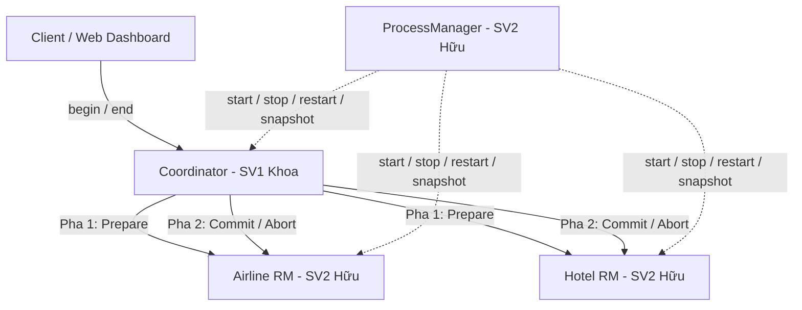

# Hướng Dẫn Kỹ Thuật, Kiến Trúc & Vận Hành — SV2 (Trần Lê Quang Hữu)

**Học phần:** Hệ thống Phân tán (INT1405) — Học viện Công nghệ Bưu chính Viễn thông (PTIT)  
**Đề tài (Track B):** Hệ thống Đặt chỗ Du lịch Phân tán với Two-Phase Commit (2PC)  
**Sinh viên 2 (SV2):** **Trần Lê Quang Hữu** (MSSV: `N23DCCN024`, GitHub: `@n23dccn024-commits`)  
**Nhánh Git:** `feat/13-lifecycle-manager`  
**Pull Request đang mở:** [PR #38 trên GitHub](https://github.com/KhoaTryHard/travel-reservation-2pc/pull/38)  
**Reviewers:** `@KhoaTryHard` (Nhóm trưởng / SV1), `@Khanh0338` (SV3)

---

## ⚡ 1. CHẠY THỬ NGHIỆM DỰ ÁN NGAY (QUICK START)

Để bạn có thể nhìn thấy ngay toàn bộ hệ thống hoạt động trước mắt chỉ với **1 lệnh duy nhất**, chúng tôi đã chuẩn bị sẵn file kịch bản trực quan `demo_sv2.py`.

### Bước 1: Mở PowerShell và di chuyển vào thư mục dự án
```powershell
cd F:\K1_N4_HTPT\travel-reservation-2pc
```

### Bước 2: Chạy bản demo trực quan của bạn
```powershell
$env:PATH = "C:\Users\TRAN HUU\AppData\Local\Programs\Python\Python313;" + $env:PATH
python demo_sv2.py
```

### 👉 Những gì bạn sẽ được chứng kiến trực tiếp trên màn hình:
1. **Khởi động 3 server phân tán độc lập:** `ProcessManager` (do bạn viết) tự động khởi chạy 3 tiến trình nền:
   - **Coordinator:** Cổng `8000`, DB: `data/coordinator.db`
   - **Airline:** Cổng `8001`, DB: `data/airline.db`
   - **Hotel:** Cổng `8002`, DB: `data/hotel.db`
2. **Kiểm tra trạng thái (Snapshot):** Giám sát phi chặn thông qua PID, port, trạng thái hoạt động của từng node.
3. **Thực thi giao dịch 2PC đặt combo du lịch:**
   - Client gửi yêu cầu với mã `Booking Token`.
   - **Pha 1 (Prepare):** Coordinator hỏi Airline và Hotel xem còn chỗ không. Hai bên kiểm tra tồn kho, khóa tài nguyên (`locks`) và ghi tạm ứng `PREPARED`. Cả hai bỏ phiếu **YES**.
   - **Pha 2 (Commit):** Coordinator ra quyết định **GLOBAL_COMMIT**. Hai bên trừ kho từ **5 $\rightarrow$ 4**, giải phóng khóa và xác nhận thành công.
4. **Chống trừ tiền trùng (Idempotency):** Gửi lại chính xác `Booking Token` cũ. Hệ thống thông minh nhận diện yêu cầu cũ, trả về kết quả đã commit mà **kho không bị trừ lần 2** (vẫn còn nguyên 4).
5. **Thử nghiệm sự cố Crash & Phục hồi (Recovery):** Đột ngột ngắt tiến trình `Hotel` (`stop`), kiểm tra snapshot báo `stopped`. Sau đó khởi động lại (`restart`), **dữ liệu trong SQLite DB cũ vẫn còn nguyên vẹn 100%**.
6. **Dọn dẹp tự động (Cleanup):** `ProcessManager` tắt toàn bộ tiến trình con khi kết thúc, không để lại tiến trình rác chạy ngầm.

---

## 2. Tổng quan Dự án & Phân công Nhiệm vụ

Hệ thống mô phỏng bài toán kinh điển trong Hệ thống phân tán: Khách hàng đặt trọn gói một chuyến du lịch gồm **1 vé máy bay (Airline)** và **1 phòng khách sạn (Hotel)**. Yêu cầu giao dịch phải đạt tính **nguyên tử (Atomicity)**:
- Hoặc **cả 2 cùng đặt thành công** (Global Commit).
- Hoặc nếu một bên hết chỗ hoặc gặp sự cố, **cả 2 phải cùng hủy** (Global Abort), không bao giờ có chuyện đặt được máy bay mà không có phòng khách sạn.



### Phân công trách nhiệm 3 sinh viên:
- **SV1 (Nguyễn Đăng Khoa):** 2PC Coordinator / TP Monitor, API Backend cho Web Dashboard, cơ chế điều phối và lưu trữ trạng thái giao dịch.
- **SV2 (Trần Lê Quang Hữu - Bạn):** 
  - **Resource Manager (Airline & Hotel):** Quản lý 2 cơ sở dữ liệu độc lập, cơ chế khóa cục bộ (`locks`), ghi tạm ứng (`tentative writes` / `PREPARED`), bảo toàn dữ liệu bằng SQLite WAL.
  - **Process Manager ([lifecycle.py](file:///F:/K1_N4_HTPT/travel-reservation-2pc/lifecycle.py)):** Trình quản lý vòng đời tiến trình cho Web Dashboard, điều khiển start/stop/restart, phát hiện sự cố crash, xử lý cổng bận an toàn.
- **SV3 (Dương Quốc Khánh):** Giao diện Web Dashboard (frontend) và kịch bản bơm lỗi / kiểm thử tải (Chaos injector).

---

## 3. Kiến trúc Kỹ thuật Module của SV2

### 3.1. Cơ chế Lưu trữ Bền vững & Khóa Đồng thời (`participant.py`, `common.py`)

Mỗi Participant (Airline và Hotel) sở hữu một file cơ sở dữ liệu SQLite riêng biệt, hoạt động ở chế độ **WAL (Write-Ahead Logging)** với cấu trúc 4 bảng:

| Tên Bảng SQLite | Mục đích & Ràng buộc chính | Thời điểm cập nhật |
|---|---|---|
| `inventory` | Lưu số lượng chỗ còn lại (`resource` là PK, `available >= 0`). Mặc định có 5 chỗ `DEFAULT`. | Chỉ trừ 1 khi có lệnh **COMMIT** ở Pha 2. |
| `locks` | Khóa tài nguyên độc quyền (`resource` PK, `tx` UNIQUE). | Ghi khóa ở Pha 1 (`PREPARE`), xóa khóa ở Pha 2 (`COMMIT`/`ABORT`). |
| `reservations` | Lưu trạng thái giao dịch (`tx` PK, `state`: `PREPARED`, `COMMITTED`, `ABORTED`). | Tạo bản ghi ở Pha 1, đổi trạng thái ở Pha 2. |
| `events` | Nhật ký sự kiện cục bộ theo số thứ tự `seq` tăng dần. | Ghi lại mỗi khi có thay đổi trạng thái giao dịch. |

#### Quy trình Two-Phase Commit tại Participant:
1. **Pha 1 (`prepare`):**
   - Kiểm tra: `inventory.available > 0` và `locks` chưa bị giao dịch khác chiếm giữ.
   - Thực thi nguyên tử trong 1 local transaction: Tạo bản ghi trong `locks` và ghi `PREPARED` vào `reservations`.
   - Trả lời Coordinator: **VOTE YES** (nếu thỏa mãn) hoặc **VOTE NO** (nếu hết chỗ / xung đột).
2. **Pha 2 (`commit` / `abort`):**
   - Nếu nhận `commit`: Đổi reservation sang `COMMITTED`, trừ 1 tồn kho trong `inventory`, xóa khóa trong `locks`.
   - Nếu nhận `abort`: Đổi reservation sang `ABORTED`, xóa khóa trong `locks`, giữ nguyên tồn kho.
   - Nếu nhận `abort` khi chưa từng nhận `prepare` (do timeout mạng): Ghi bản ghi **Tombstone** (`resource = NULL`) để nếu gói tin prepare muộn đến sau sẽ bị từ chối ngay lập tức.
3. **Phục hồi sau sự cố (Crash Recovery):**
   - Khóa và trạng thái `PREPARED` được ghi bền vững trên đĩa. Nếu server bị sập đột ngột rồi khởi động lại, khóa vẫn được bảo toàn cho đến khi nhận được quyết định chính thức từ Coordinator.

---

### 3.2. Trình Quản lý Tiến trình ([lifecycle.py](file:///F:/K1_N4_HTPT/travel-reservation-2pc/lifecycle.py))

`ProcessManager` được thiết kế chặt chẽ theo các nguyên tắc an toàn hệ thống:
- **Nguyên tắc Quyền sở hữu (Ownership):** Chỉ quản lý các child process do chính nó tạo ra bằng `subprocess.Popen(..., shell=False)`. Tuyệt đối không can thiệp, nhận diện hay tắt nhầm tiến trình ngoài hệ điều hành.
- **Xử lý Cổng bận (Port Busy):** Khi gọi `start`, nếu cổng mạng đang bị một ứng dụng khác chiếm giữ, hệ thống trả về mã lỗi HTTP 409 `port_busy` và từ chối khởi động đè.
- **Bảo toàn Cơ sở dữ liệu:** Khi `restart`, tiến trình mới được trỏ đúng vào đường dẫn file DB cũ, đảm bảo tính liên tục của dữ liệu.
- **Giám sát Phi chặn (Non-blocking):** Phương thức `snapshot()` sử dụng `process.poll()` để kiểm tra trạng thái tức thì, không làm treo ứng dụng web và phát hiện node bị crash ngay lập tức.
- **Cách ly I/O:** Đầu ra `stdout` và `stderr` được ghi thẳng ra file log riêng biệt `logs/<name>.log`, tránh làm đầy bộ đệm pipe gây đơ tiến trình.

---

## 4. Bằng chứng Kiểm thử (Test Evidence)

Bộ kiểm thử [tests/test_lifecycle.py](file:///F:/K1_N4_HTPT/travel-reservation-2pc/tests/test_lifecycle.py) gồm 8 test case thực tế:

| STT | Bài kiểm tra | Kết quả | Ý nghĩa kiểm tra |
|---|---|---|---|
| 1 | `test_start_is_idempotent_and_stop_is_harmless` | ✅ PASS | Start 2 lần trả về cùng PID; Stop 2 lần an toàn không lỗi |
| 2 | `test_restart_keeps_the_same_database` | ✅ PASS | Restart node vẫn giữ nguyên dữ liệu trong DB cũ |
| 3 | `test_busy_port_is_reported_and_external_process_is_untouched` | ✅ PASS | Cổng bận trả 409, không tắt ứng dụng ngoài |
| 4 | `test_crash_is_isolated_not_auto_restarted_and_prepared_survives` | ✅ PASS | Node bị sập snapshot báo failed; khóa `PREPARED` trong DB sống sót |
| 5 | `test_concurrent_start_creates_exactly_one_child` | ✅ PASS | Nhiều luồng đồng thời gọi start chỉ sinh ra đúng 1 tiến trình |
| 6 | `test_snapshot_lists_three_nodes_even_when_nothing_runs` | ✅ PASS | Snapshot hiển thị đủ 3 node ngay cả khi chưa chạy |
| 7 | `test_close_all_stops_owned_children_and_keeps_data` | ✅ PASS | Dọn dẹp gọn gàng toàn bộ child process khi tắt ứng dụng |
| 8 | `test_unknown_service_or_action_is_rejected` | ✅ PASS | Từ chối dịch vụ hoặc thao tác sai với mã 400 |

---

## 5. Các Lệnh Hữu Ích Dành Cho Bạn

### 1. Chạy bản demo trực quan:
```powershell
$env:PATH = "C:\Users\TRAN HUU\AppData\Local\Programs\Python\Python313;" + $env:PATH
python demo_sv2.py
```

### 2. Chạy bộ kiểm thử tự động của SV2:
```powershell
$env:PATH = "C:\Users\TRAN HUU\AppData\Local\Programs\Python\Python313;" + $env:PATH
python -m unittest tests.test_lifecycle -v
```

### 3. Chạy bộ kiểm thử toàn hệ thống 2PC:
```powershell
$env:PATH = "C:\Users\TRAN HUU\AppData\Local\Programs\Python\Python313;" + $env:PATH
python -m unittest tests.test_system -v
```

### 4. Khởi chạy Dashboard API của Khoa (để chuẩn bị ghép nối UI):
```powershell
$env:PATH = "C:\Users\TRAN HUU\AppData\Local\Programs\Python\Python313;" + $env:PATH
python run_dashboard_api.py --port 8080
```
*(Mở trình duyệt truy cập: `http://127.0.0.1:8080/api/overview` để xem JSON trạng thái).*
