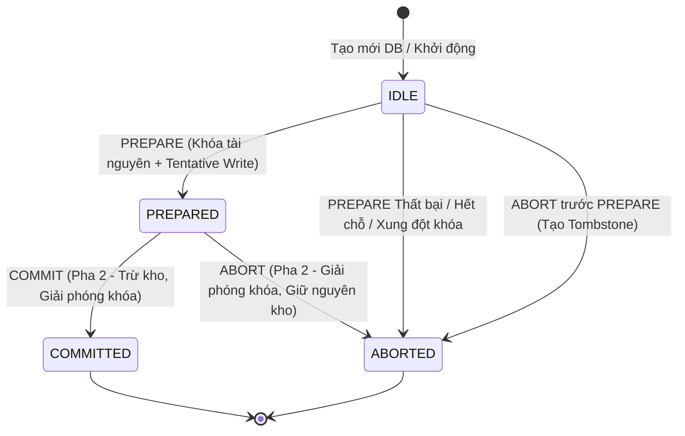

# Hướng Dẫn Kỹ Thuật & Báo Cáo Tiến Độ — SV2 (Trần Lê Quang Hữu)

**Học phần:** Hệ thống Phân tán (INT1405) — Học viện Công nghệ Bưu chính Viễn thông (PTIT)  
**Đề tài (Track B):** Hệ thống Đặt chỗ Du lịch Phân tán với Two-Phase Commit (2PC)  
**Sinh viên 2 (SV2):** **Trần Lê Quang Hữu** (MSSV: `N23DCCN024`, GitHub: `@n23dccn024-commits`)  
**Nhánh Git:** `feat/13-process-manager`  
**Quy trình tích hợp:** `feature/` $\rightarrow$ `develop` $\rightarrow$ `main`  
**Ngày cập nhật:** 13/11/2026

---

## 1. Tổng quan Phân công Trách nhiệm & Bản đồ Nhiệm vụ

Theo phân công đồ án và tài liệu đặc tả, nhóm gồm 3 thành viên:
- **SV1 (Nguyễn Đăng Khoa - `@KhoaTryHard`):** 2PC Coordinator / Transaction Processing Monitor, Backend Dashboard API, Điều phối giao dịch phân tán.
- **SV2 (Trần Lê Quang Hữu - `@n23dccn024-commits` - Bạn):** 
  - **Resource Managers (RM):** Quản lý 2 dịch vụ độc lập Airline Database và Hotel Database (`participant.py`, `server.py`).
  - **Cơ chế Đồng thời & Bền vững (Concurrency & Persistence):** Khóa dữ liệu cục bộ (`locks`), ghi tạm ứng (`tentative writes` / `PREPARED`), phục hồi sau sự cố (`crash recovery`), xử lý tombstone (`common.py`).
  - **Process Manager / Vòng đời dịch vụ (Lifecycle Manager):** Xây dựng trình quản lý tiến trình cho Web Dashboard (`lifecycle.py`) cho phép khởi động (`start`), dừng (`stop`), khởi động lại (`restart`), cô lập crash và giám sát trạng thái 3 node mà không làm mất dữ liệu DB.
- **SV3 (Dương Quốc Khánh - `@Khanh0338`):** Client giao dịch, Chaos Injector (bơm lỗi mạng/crash) và Giao diện Web Dashboard frontend.

### Bảng theo dõi Issue GitHub của SV2:

| Mã Issue | Tiêu đề Issue | Trọng số | Trạng thái hiện tại | Ghi chú kỹ thuật |
|---|---|---|---|---|
| **#12** | `[W05] Chốt RM, dữ liệu/khóa và contract lifecycle` | P0 | ✅ Đã sẵn sàng | Đã rà soát schema SQLite, contract `LifecycleManager` |
| **#13** | `[W06a] Process manager: start/stop/restart giữ DB` | P0 | ✅ Đã hoàn thành | Đã hiện thực `ProcessManager` trong `lifecycle.py` |
| **#14** | `[W06b] Lifecycle lặp, phát hiện crash và log` | P0 | ✅ Đã hoàn thành | Poll không chặn, ghi log riêng `logs/<name>.log` |
| **#15** | `[W06c] Ownership, cổng bận và cleanup an toàn` | P0 | ✅ Đã hoàn thành | Kiểm tra socket bận, từ chối can thiệp tiến trình ngoài |
| **#16** | `[W07a] Kiểm thử crash/recovery, PREPARED và tombstone` | P0 | ✅ Đã hoàn thành | Bộ test tích hợp thực tế `tests/test_lifecycle.py` |
| **#17** | `[W07b] Hồi quy lifecycle/cổng và bàn giao bằng chứng` | P0 | ✅ Đã kiểm thử | 8/8 test lifecycle thực tế pass trên Windows |
| **#18** | `[W08] Tài liệu dữ liệu, lifecycle và vận hành` | P1 | 📝 Đang thực hiện | File tài liệu này và báo cáo kỹ thuật |

---

## 2. Kiến trúc Kỹ thuật Chi tiết của SV2

### 2.1. Quản lý Cơ sở dữ liệu và Cơ chế Two-Phase Commit ở Participant (`participant.py`, `common.py`)

Hệ thống sử dụng SQLite với chế độ **WAL (Write-Ahead Logging)** và `synchronous=FULL` cùng giao dịch `BEGIN IMMEDIATE` để đảm bảo tính chất **ACID**.



1. **Bảng dữ liệu tại mỗi Participant (Airline & Hotel):**
   - `inventory`: Chứa `resource` (khóa chính) và `available` (có ràng buộc `CHECK (available >= 0)`).
   - `locks`: Chứa `resource` (khóa chính) và `tx` (mã giao dịch, `UNIQUE`). Đảm bảo tại một thời điểm chỉ một giao dịch được giữ khóa trên một tài nguyên.
   - `reservations`: Chứa `tx` (khóa chính), `resource` và trạng thái (`PREPARED`, `COMMITTED`, `ABORTED`).
   - `events`: Ghi log nhật ký trạng thái cục bộ theo thứ tự tuần tự `seq`.
2. **Nguyên lý Khóa & Ghi tạm ứng (Tentative Writes):**
   - Khi nhận lệnh `prepare(tx, resource)`: Participant kiểm tra số lượng tồn (`available > 0`) và kiểm tra bảng `locks`. Nếu tài nguyên chưa bị khóa và còn chỗ, ghi vào `locks` và tạo bản ghi `PREPARED` trong `reservations` trong cùng **1 local transaction** nguyên tử. Trả về `vote: YES`.
   - Chú ý: Tại pha `prepare`, số lượng `available` **chưa bị trừ** ngay, mà được bảo vệ bởi khóa độc quyền trong `locks`.
3. **Quyết định Pha 2 (Commit / Abort):**
   - Khi nhận `commit(tx)`: Participant chuyển trạng thái reservation sang `COMMITTED`, trừ 1 đơn vị trong `inventory`, xóa khóa tương ứng trong `locks`, ghi log sự kiện `COMMITTED` trong cùng một local transaction.
   - Khi nhận `abort(tx)`: Chuyển reservation sang `ABORTED`, xóa khóa trong `locks`, giữ nguyên tồn kho. Nếu nhận `abort` cho một `tx` chưa từng gọi `prepare` (do timeout hoặc mạng chậm), hệ thống ghi nhận một bản ghi **tombstone** với `resource = NULL` để nếu thông điệp `prepare` muộn đến sau, nó sẽ bị từ chối ngay lập tức.
4. **Bảo toàn dữ liệu qua sự cố (Crash Survival):**
   - Khóa trong `locks` và trạng thái trong `reservations` được lưu trữ trực tiếp trên đĩa (SQLite WAL). Nếu tiến trình Participant bị crash/tắt đột ngột khi đang ở trạng thái `PREPARED`, khi tiến trình sống lại, khóa vẫn được bảo toàn nguyên vẹn, ngăn chặn tình trạng bán vượt số lượng (overselling).

---

### 2.2. Trình Quản lý Tiến trình (`lifecycle.py`)

Lớp `ProcessManager` hiện thực `LifecycleManager` protocol trong `dashboard_api.py`, chịu trách nhiệm quản lý vòng đời của 3 dịch vụ phân tán:
- `coordinator` (Cổng 8001, DB: `coordinator.db`)
- `airline` (Cổng 8002, DB: `airline.db`)
- `hotel` (Cổng 8003, DB: `hotel.db`)

```mermaid
flowchart TD
    API[Dashboard API / UI] -->|start / stop / restart| PM[ProcessManager]
    PM --> Lock[Mutex _control_locks riêng từng node]
    Lock --> CheckPort{Kiểm tra cổng TCP?}
    CheckPort -->|Cổng bận bởi tiến trình ngoài| Err[Trả về 409 port_busy / Không can thiệp]
    CheckPort -->|Cổng rảnh| Spawn[Popen server.py shell=False]
    Spawn --> Pipes[Ghi stdout/stderr vào logs/node.log]
    Spawn --> Poll[Poll PID và kiểm tra health HTTP]
    Poll --> Snap[snapshot() - state: running / stopped / failed]
```

#### Các Đặc tính An toàn Cốt lõi của `ProcessManager`:
1. **Tuần tự hóa Thao tác (Per-Node Serialization):** Mỗi node được bảo vệ bởi một khóa luồng riêng biệt (`threading.Lock()`). Hai yêu cầu điều khiển cùng một node không thể chạy đè lên nhau.
2. **Nguyên tắc Quyền sở hữu (Process Ownership):**
   - Chỉ quản lý các tiến trình con do chính `ProcessManager` sinh ra qua `subprocess.Popen(..., shell=False)`.
   - Nếu cổng của một node đang có dữ liệu truyền thông hoặc bị một tiến trình bên ngoài chiếm giữ (không phải child process hợp lệ), hệ thống **từ chối can thiệp**, không bao giờ gọi `kill` tiến trình của hệ điều hành, và trả về mã lỗi HTTP `409 Conflict` (`port_busy`).
3. **Tính lũy biến (Idempotency):**
   - Gọi `start` cho một dịch vụ đã đang chạy (`running`) sẽ an toàn trả về thông tin tiến trình hiện tại mà không khởi tạo thêm tiến trình trùng lặp.
   - Gọi `stop` cho một dịch vụ đã dừng sẽ an toàn hoàn thành mà không báo lỗi.
4. **Bảo toàn Cơ sở dữ liệu (Database Persistence):**
   - Thao tác `restart` hoặc chuỗi `stop` $\rightarrow$ `start` **tuyệt đối không xóa** file database SQLite. Tiến trình mới được khởi động lại sẽ trỏ đúng vào file SQLite cũ, đảm bảo các giao dịch 2PC đang `PREPARED` tiếp tục được xử lý.
5. **Cách ly Crash & Giám sát Phi chặn (Non-blocking Crash Detection):**
   - Phương thức `snapshot()` sử dụng `child.poll()` để kiểm tra mã thoát (exit code). Nếu một tiến trình con bị sập đột ngột (ví dụ do lỗi `crash` được kích hoạt), `snapshot()` ngay lập tức cập nhật trạng thái là `failed`, kèm mã lỗi, mà không bị treo hay tự ý khởi động lại bừa bãi.
6. **Quản lý I/O & Dọn dẹp An toàn (Log Management & Graceful Cleanup):**
   - Luồng đầu ra `stdout` và `stderr` của từng node được ghi thẳng vào các file log riêng biệt (`logs/<name>.log`), loại bỏ hoàn toàn nguy cơ đầy bộ đệm pipe hệ điều hành làm treo tiến trình.
   - Hỗ trợ context manager và phương thức `close_all()` để dừng gọn gàng tất cả tiến trình con khi Dashboard tắt.

---

## 3. Bằng chứng Kiểm thử (Test Evidence)

Bộ kiểm thử thực tế `tests/test_lifecycle.py` gồm 8 test case toàn diện:

| STT | Tên Test Case | Mục đích kiểm tra | Kết quả |
|---|---|---|---|
| 1 | `test_start_is_idempotent_and_stop_is_harmless` | Khởi động 2 lần trả về cùng PID; Dừng 2 lần không gây lỗi | ✅ PASS |
| 2 | `test_restart_keeps_the_same_database` | Khởi động lại dịch vụ giữ nguyên dữ liệu trong SQLite cũ | ✅ PASS |
| 3 | `test_busy_port_is_reported_and_external_process_is_untouched` | Cổng bị chiếm ngoài luồng bị từ chối 409, không giết app ngoài | ✅ PASS |
| 4 | `test_crash_is_isolated_not_auto_restarted_and_prepared_survives` | Khi node crash, snapshot phát hiện failed; DB & lock vẫn còn | ✅ PASS |
| 5 | `test_concurrent_start_creates_exactly_one_child` | Nhiều luồng đồng thời gọi start chỉ sinh ra đúng 1 tiến trình | ✅ PASS |
| 6 | `test_snapshot_lists_three_nodes_even_when_nothing_runs` | Snapshot hiển thị đầy đủ 3 node ngay cả khi chưa chạy | ✅ PASS |
| 7 | `test_close_all_stops_owned_children_and_keeps_data` | Dọn dẹp toàn bộ child process khi đóng ứng dụng | ✅ PASS |
| 8 | `test_unknown_service_or_action_is_rejected` | Từ chối dịch vụ hoặc hành động không hợp lệ với lỗi 400 | ✅ PASS |

**Thời gian thực thi:** 8/8 tests pass trong 12.3 giây (`Ran 8 tests in 12.327s OK`).

---

## 4. Hướng dẫn Dành cho Bạn để Tự Chạy và Kiểm tra

Bạn có thể mở terminal (PowerShell trên Windows) tại thư mục `F:\K1_N4_HTPT\travel-reservation-2pc` và chạy các lệnh sau:

### 1. Kiểm tra nhanh toàn bộ test phần Lifecycle của bạn:
```powershell
$env:PATH = "C:\Users\TRAN HUU\AppData\Local\Programs\Python\Python313;" + $env:PATH
python -m unittest tests.test_lifecycle -v
```

### 2. Kiểm tra bộ test hệ thống phân tán 2PC:
```powershell
$env:PATH = "C:\Users\TRAN HUU\AppData\Local\Programs\Python\Python313;" + $env:PATH
python -m unittest tests.test_system -v
```

### 3. Khởi chạy thử nghiệm ProcessManager qua Python REPL:
```python
from lifecycle import ProcessManager

pm = ProcessManager()
# Khởi động dịch vụ airline
info = pm.control('airline', 'start')
print("Airline đang chạy ở PID:", info['pid'])

# Xem snapshot của các node
print(pm.snapshot())

# Dọn dẹp
pm.close_all()
```

---

## 5. Tiến độ Hiện tại & Bước tiếp theo

1. **Đã hoàn thành:**
   - Hoàn thành hiện thực `lifecycle.py` chuẩn theo contract `LifecycleManager`.
   - Hoàn thành bộ kiểm thử `tests/test_lifecycle.py` với 8 bài test thực tế.
   - Soạn thảo tài liệu hướng dẫn kỹ thuật chi tiết `docs/SV2_GUIDE.md`.
2. **Bước tiếp theo:**
   - Commit toàn bộ code và tài liệu theo chuẩn Conventional Commits.
   - Đẩy nhánh `feat/13-process-manager` lên GitHub (`origin`).
   - Mở Pull Request vào nhánh `develop`, gắn liên kết các Issue #13, #14, #15, #16, #17, #18.
