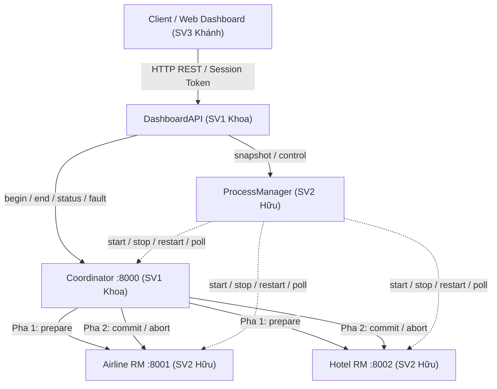

# Tài Liệu Kỹ Thuật, Kiến Trúc Dữ Liệu, Lifecycle & Vận Hành — SV2 (Trần Lê Quang Hữu)

**Học phần:** Hệ thống Phân tán (INT1405) — Học viện Công nghệ Bưu chính Viễn thông (PTIT)  
**Đề tài (Track B):** Hệ thống Đặt chỗ Du lịch Phân tán với Two-Phase Commit (2PC)  
**Sinh viên 2 (SV2):** **Trần Lê Quang Hữu** (MSSV: `N23DCCN024`, GitHub: `@n23dccn024-commits`)  
**Nhánh Git:** `feat/13-lifecycle-manager`  
**Pull Request:** [PR #38 trên GitHub](https://github.com/KhoaTryHard/travel-reservation-2pc/pull/38)  
**Phạm vi công việc:** `W05` (#12), `W06a` (#13), `W06b` (#14), `W06c` (#15), `W07a` (#16), `W07b` (#17), `W08` (#18)

---

## 1. Khởi chạy Nhanh & Kiểm thử (Quick Start)

### 1.1. Chạy bản demo trực quan phần SV2 (`demo_sv2.py`)
Từ thư mục gốc của kho mã nguồn (`travel-reservation-2pc`):
```powershell
python demo_sv2.py
```

Kịch bản [demo_sv2.py](../demo_sv2.py) tự động khởi chạy 3 tiến trình thật qua [lifecycle.py](../lifecycle.py):
- **Coordinator:** `127.0.0.1:8000` — DB: `data/coordinator.db`
- **Airline RM:** `127.0.0.1:8001` — DB: `data/airline.db`
- **Hotel RM:** `127.0.0.1:8002` — DB: `data/hotel.db`

### 1.2. Chạy bộ kiểm thử Lifecycle & Recovery thực tế (`tests/test_lifecycle.py`)
```powershell
python -m unittest discover -s tests -p "test_lifecycle.py" -v
```

### 1.3. Chạy toàn bộ bộ kiểm thử tích hợp của dự án
```powershell
python -m unittest discover -s tests -v
```

---

## 2. Kiến trúc Module của SV2 & Phân công Nhóm



- **SV1 (Nguyễn Đăng Khoa — `@KhoaTryHard`):** Coordinator 2PC ([coordinator.py](../coordinator.py)), Dashboard Backend API & HTTP boundary ([dashboard_api.py](../dashboard_api.py), [run_dashboard_api.py](../run_dashboard_api.py)), điều phối tích hợp và báo cáo.
- **SV2 (Trần Lê Quang Hữu — `@n23dccn024-commits`):**
  - **Resource Managers ([participant.py](../participant.py), [common.py](../common.py)):** Quản lý dữ liệu SQLite WAL cho `airline` và `hotel`, khóa giao dịch (`locks`), bản ghi tạm ứng (`PREPARED`), idempotent commit/abort, tombstone chống gói tin `PREPARE` đến muộn.
  - **Process Manager ([lifecycle.py](../lifecycle.py)):** Quản lý vòng đời tiến trình con (`start`, `stop`, `restart`, `snapshot`, `close_all`) theo giao thức `LifecycleManager` trong [docs/DASHBOARD_SPEC.md](DASHBOARD_SPEC.md).
- **SV3 (Dương Quốc Khánh — `@Khanh0338`):** Giao diện Web Dashboard tiếng Việt, bộ công cụ bơm lỗi/chạy tải và kiểm thử trình duyệt.

---

## 3. Thiết kế Cơ sở Dữ liệu, Khóa Giao dịch & Phục hồi (`W05`, `W07a`, `W08`)

### 3.1. Sơ đồ Cơ sở Dữ liệu SQLite tại Participant ([participant.py](../participant.py))

Mỗi Resource Manager (`airline` và `hotel`) sử dụng một tệp SQLite độc lập ở chế độ **WAL (`PRAGMA journal_mode=WAL; PRAGMA synchronous=FULL;`)** gồm 4 bảng:

| Bảng | Cột & Ràng buộc chính | Vai trò trong 2PC |
|---|---|---|
| `inventory` | `resource TEXT PRIMARY KEY`, `available INTEGER NOT NULL CHECK(available >= 0)` | Lưu tồn kho thực tế (mặc định `DEFAULT = 5`). **Chỉ trừ 1 khi nhận quyết định `COMMIT`**; không bao giờ âm (`available >= 0`). |
| `locks` | `resource TEXT PRIMARY KEY`, `tx TEXT NOT NULL UNIQUE`, `updated REAL NOT NULL` | Khóa độc quyền trên từng `resource` trong pha `PREPARE`. Ngăn hai giao dịch đồng thời giữ cùng một tài nguyên. |
| `reservations` | `tx TEXT PRIMARY KEY`, `resource TEXT`, `state TEXT NOT NULL`, `updated REAL NOT NULL` | Lưu trạng thái giao dịch tại RM: `PREPARED`, `COMMITTED`, hoặc `ABORTED`. Khi ghi tombstone cho giao dịch chưa từng `PREPARE`, cột `resource` mang giá trị `NULL` và `state = 'ABORTED'`. |
| `events` | `seq INTEGER PRIMARY KEY AUTOINCREMENT`, `ts REAL NOT NULL`, `tx TEXT`, `event TEXT NOT NULL`, `detail TEXT` | Nhật ký sự kiện bền vững theo thứ tự thời gian phục vụ đối chiếu trên Dashboard. |

### 3.2. Quy tắc Đối chiếu Tồn kho, Khóa và Trạng thái Giao dịch (`W05`)
1. **Pha 1 (`prepare`):**
   - Nếu `tx` đã tồn tại trong `reservations`:
     - Trả `vote = True` nếu `state IN ('PREPARED', 'COMMITTED')` và `resource` khớp (idempotent).
     - Trả `vote = False` nếu `state == 'ABORTED'` (bao gồm cả trường hợp **tombstone** do Coordinator đã hủy vì timeout trước khi gói tin `PREPARE` đến).
   - Nếu `tx` mới: Kiểm tra `locks` trên `resource` trống và `inventory.available > 0`. Nếu thỏa mãn, ghi nguyên tử vào `locks` và `reservations(tx, resource, 'PREPARED')` trong cùng một giao dịch SQLite (`with self.db:`). **Chưa trừ `inventory.available` ở pha 1.**
2. **Pha 2 (`commit` / `abort`):**
   - **`commit(tx)`:**
     - Nếu `state == 'COMMITTED'`: trả kết quả thành công ngay lập tức (**idempotent commit** — tuyệt đối không trừ `inventory.available` lần thứ hai khi Coordinator phát lại lệnh `COMMIT` do mất ACK).
     - Nếu `state == 'PREPARED'`: cập nhật `UPDATE inventory SET available = available - 1`, chuyển `reservations.state = 'COMMITTED'`, và xóa bản ghi trong `locks`.
   - **`abort(tx)`:**
     - Nếu `state == 'ABORTED'`: trả kết quả ngay (idempotent).
     - Nếu `state == 'PREPARED'`: chuyển `reservations.state = 'ABORTED'`, xóa bản ghi trong `locks`, giữ nguyên `inventory.available`.
     - Nếu `tx` chưa có trong `reservations`: chèn bản ghi **tombstone** `(tx, NULL, 'ABORTED')` để chặn mọi gói tin `PREPARE` đến muộn không thể hồi sinh khóa.
3. **Cách UI/API đọc dữ liệu:**
   - Số chỗ hiển thị trên thẻ node lấy từ `inventory.available` qua RPC `snapshot`, kèm danh sách khóa đang giữ trong `locks` (`PREPARED`).
   - Ngay cả khi `available > 0`, một yêu cầu đặt chỗ mới vẫn sẽ trả `VOTE_NO` nếu tài nguyên `DEFAULT` đang bị giữ bởi một khóa trong bảng `locks`.

---

## 4. Thiết kế ProcessManager & Quy tắc Vận hành An toàn (`W06a`, `W06b`, `W06c`, `W08`)

[lifecycle.py](../lifecycle.py) hiện thực lớp `ProcessManager` tuân thủ đầy đủ giao thức `LifecycleManager` của [dashboard_api.py](../dashboard_api.py):

| Thuộc tính / Phương thức | Chi tiết kỹ thuật |
|---|---|
| **Bản đồ dịch vụ cố định (`SERVICES`)** | `coordinator` (`127.0.0.1:8000`, `data/coordinator.db`), `airline` (`127.0.0.1:8001`, `data/airline.db`), `hotel` (`127.0.0.1:8002`, `data/hotel.db`). Không nhận đường dẫn thực thi, shell hay tham số dòng lệnh từ trình duyệt. |
| **`snapshot()`** | Đọc trạng thái phi chặn (non-blocking) cho `/api/overview`. Tự động gọi `proc.poll()` để phát hiện tiến trình con tự thoát (ví dụ chaos hook `os._exit(86)`) và chuyển `state` sang `'failed'` kèm mã thoát, không tự động khởi động lại để người vận hành quan sát sự cố. |
| **`control(name, action)`** | Hỗ trợ `start`, `stop`, `restart` cho 3 dịch vụ cố định. Dịch vụ hoặc hành động lạ bị từ chối với `LifecycleError(404, 'not_found', ...)`. Tuần tự hóa thao tác trên từng node bằng khóa riêng `_control_locks[name]`. |
| **Quyền sở hữu & Cổng bận (`409 port_busy`)** | Chỉ điều khiển hoặc dừng tiến trình con do chính `ProcessManager` sinh ra qua `subprocess.Popen(..., shell=False)`. Khi `start`, nếu cổng đã có tiến trình ngoài lắng nghe (`_port_busy`), trả ngay `LifecycleError(409, 'port_busy', ...)` và không nhận quyền sở hữu hay tắt tiến trình ngoài. |
| **Bảo toàn DB & Log riêng** | `restart` và `start` luôn dùng lại đúng tệp SQLite hiện có trong `data/`. Đầu ra `stdout`/`stderr` của từng tiến trình con được ghi trực tiếp vào `logs/<name>.log`, ngăn chặn tình trạng đầy bộ đệm pipe làm treo tiến trình. |
| **Dọn dẹp an toàn (`close_all`)** | Khi tắt Dashboard (`Ctrl+C` / `finally`), `close_all()` gửi `terminate()` (chờ tối đa `5s` trước khi `kill()`) tới các tiến trình con thuộc quyền sở hữu và giữ nguyên toàn bộ tệp `.db`. |

### Hướng dẫn Vận hành & Xử lý Sự cố (`W08`)
1. **Xử lý lỗi cổng bận (`409 port_busy`):**
   - Nếu cổng `8000`, `8001`, hoặc `8002` đang bị một tiến trình cũ bên ngoài chiếm giữ, Dashboard sẽ báo lỗi `port_busy` (`409`).
   - Cách xử lý: Đóng terminal đang chạy tiến trình cũ hoặc truyền cổng tùy chỉnh qua tham số `--coordinator-port`, `--airline-port`, `--hotel-port` khi khởi chạy Dashboard.
2. **Xem nhật ký tiến trình (`logs/`):**
   - Nhật ký chi tiết của từng node nằm tại `logs/coordinator.log`, `logs/airline.log`, `logs/hotel.log`.
3. **Chuẩn bị dữ liệu sạch trước buổi Demo & Quy tắc khi Demo Crash/Recovery:**
   - **Trước buổi demo:** Khi toàn bộ dịch vụ đã dừng (`stopped`), có thể xóa thư mục `data/` (hoặc dùng thư mục `--data-dir` mới) để khởi tạo lại tồn kho mặc định `DEFAULT = 5` cho cả Airline và Hotel.
   - **Trong lúc demo kịch bản Crash / Recovery:** **Tuyệt đối không xóa hay reset thư mục `data/`** giữa lúc node sập và lúc bấm `Start` / `Restart`. Việc giữ nguyên tệp `.db` giúp chứng minh khóa `PREPARED` sống sót qua sự cố sập nguồn và Coordinator phát lại (replay) quyết định `COMMIT`/`ABORT` chính xác sau khi khởi động lại.

---

## 5. Bằng chứng Kiểm thử & Đối chiếu Tiêu chí Nghiệm thu (`#12` – `#18`)

### 5.1. Danh sách 11 bài kiểm thử tự động trong [tests/test_lifecycle.py](../tests/test_lifecycle.py)

| STT | Tên bài kiểm thử (`LifecycleTests`) | Issue đối chiếu | Kết quả | Nội dung kiểm chứng thực tế |
|---|---|---|---|---|
| 1 | `test_start_is_idempotent_and_stop_is_harmless` | `#13`, `#14` | PASS | `start` lặp lại trả cùng PID, không nhân đôi tiến trình; `stop` khi đã dừng là thao tác an toàn. |
| 2 | `test_restart_keeps_the_same_database` | `#13`, `#18` | PASS | Đặt chỗ trừ tồn kho `5 -> 4`, gọi `restart` sinh PID mới nhưng giữ nguyên tệp DB và tồn kho `4`. |
| 3 | `test_busy_port_is_reported_and_external_process_is_untouched` | `#15`, `#17` | PASS | Cổng bị chiếm bởi socket ngoài trả `409 port_busy`; gọi `stop` không làm đứt kết nối của tiến trình ngoài. |
| 4 | `test_crash_is_isolated_not_auto_restarted_and_prepared_survives` | `#14`, `#16` | PASS | `hotel` crash bằng mã `86` sau `prepare` chuyển sang `failed`, không tự restart, 2 node kia vẫn sống, khi bật lại `hotel` khóa `PREPARED` và tồn kho `5` còn nguyên. |
| 5 | `test_concurrent_start_creates_exactly_one_child` | `#14`, `#17` | PASS | 4 luồng gọi `start('coordinator')` đồng thời chỉ tạo đúng 1 tiến trình con duy nhất. |
| 6 | `test_snapshot_lists_three_nodes_even_when_nothing_runs` | `#13`, `#14` | PASS | `snapshot()` luôn trả đủ 3 khóa `coordinator`, `airline`, `hotel` ở trạng thái `stopped` khi mới khởi tạo. |
| 7 | `test_close_all_stops_owned_children_and_keeps_data` | `#15`, `#17` | PASS | `close_all()` dừng toàn bộ tiến trình con sở hữu và giữ nguyên tệp SQLite trên đĩa. |
| 8 | `test_unknown_service_or_action_is_rejected` | `#15` | PASS | Dịch vụ lạ (`payments`, `../x`) hoặc hành động lạ (`delete`) bị từ chối với mã HTTP `404` (`not_found`). |
| 9 | `test_http_lifecycle_boundary_and_web_survives_node_crash` | `#14`, `#15`, `#17` | PASS | Kiểm tra qua `DashboardHTTPServer` thật: chặn thiếu `X-Session-Token` (`403`), trả `409 port_busy` qua HTTP, ghi file `logs/<name>.log`, và xác nhận `GET /api/overview` vẫn sống (`200 OK`) khi `hotel` crash. |
| 10 | `test_coordinator_crash_before_and_after_decision_via_manager` | `#16`, `#17` | PASS | Qua `ProcessManager` + `DashboardAPI`: Coordinator sập trước quyết định (`after_votes`) giữ `PREPARED` rồi `ABORTED` khi bật lại (tồn `5`); sập sau quyết định (`after_decision`) phát lại `COMMIT` đúng 1 lần khi bật lại, retry cùng token không trừ tồn lần 2 (`5 -> 4`). |
| 11 | `test_lost_ack_after_commit_and_late_prepare_tombstone_via_manager` | `#16`, `#17` | PASS | Qua `ProcessManager` + `DashboardAPI`: `hotel` sập sau `commit` mất ACK (`complete=False`), khi bật lại hoàn tất ACK mà không trừ tồn 2 lần (`5 -> 4`); delay `before_prepare` quá hạn bị ghi tombstone `ABORTED`, gói `prepare` muộn không hồi sinh khóa (`locks = []`). |

### 5.2. Bảng Mapping Công việc SV2 (`W05` – `W08`)

| Issue / WBS | Đầu việc | Tệp nguồn & Bài kiểm thử chứng minh |
|---|---|---|
| **#12 (`W05`)** | Chốt RM, dữ liệu/khóa và contract lifecycle | [participant.py](../participant.py), [lifecycle.py](../lifecycle.py), Mục 3 & 4 của tài liệu này. |
| **#13 (`W06a`)** | Process manager: start/stop/restart giữ DB | [lifecycle.py](../lifecycle.py) (`_start`, `_stop`, `control`), Test 1, 2, 6 trong [tests/test_lifecycle.py](../tests/test_lifecycle.py). |
| **#14 (`W06b`)** | Lifecycle lặp, phát hiện crash và log | [lifecycle.py](../lifecycle.py) (`_refresh`, `_control_locks`, `_log_path`), Test 1, 4, 5, 6, 9 trong [tests/test_lifecycle.py](../tests/test_lifecycle.py). |
| **#15 (`W06c`)** | Ownership, cổng bận và cleanup an toàn | [lifecycle.py](../lifecycle.py) (`_port_busy`, `close_all`, `control`), Test 3, 7, 8, 9 trong [tests/test_lifecycle.py](../tests/test_lifecycle.py). |
| **#16 (`W07a`)** | Kiểm thử crash/recovery, PREPARED và tombstone | Test 4, 10, 11 trong [tests/test_lifecycle.py](../tests/test_lifecycle.py) kết hợp [tests/test_system.py](../tests/test_system.py). |
| **#17 (`W07b`)** | Hồi quy lifecycle/cổng và bàn giao bằng chứng | Toàn bộ 11/11 test trong [tests/test_lifecycle.py](../tests/test_lifecycle.py) và toàn bộ suite trên 4 môi trường CI. |
| **#18 (`W08`)** | Tài liệu dữ liệu, lifecycle và vận hành | Tài liệu [docs/SV2_GUIDE.md](SV2_GUIDE.md) này (sơ đồ DB, khóa, lifecycle, vận hành, chuẩn bị demo). |
